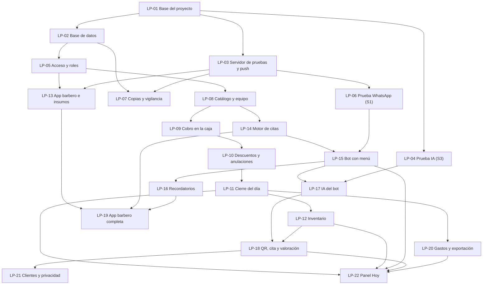

# Tickets — LOS PAPIS: caja, inventario y citas por WhatsApp

**Fecha:** 18 de octubre de 2026 · **Fuentes:** [PRD](../../los-papis-gestion-barberia.prd.md) · [Arquitectura](../../los-papis-gestion-barberia.architecture.md) · [Maqueta](https://claude.ai/artifact/L2wVJFP3VQK19vafBSJEmY)

## Resumen

El objetivo es que en LOS PAPIS cada euro, corte y producto quede registrado a nombre de alguien, que la caja cuadre cada día con un margen de 2 € y que los clientes aprendan a reservar por WhatsApp en italiano o español. Todo tiene que estar listo para pruebas a finales de enero de 2027.

Son **22 tickets** y siguen el orden de etapas del PRD:

- etapa 0: base y pruebas de riesgo;
- etapa 1: caja;
- etapa 2: inventario;
- etapa 3: citas y WhatsApp;
- etapa 4: panel y app del barbero.

Cada ticket es una sola cosa que se puede probar por separado y trae su propio contexto, así que un ciclo PIV puede empezarlo sin releer todo el proyecto.

**Proyecto desde cero:** todavía no hay código. Las carpetas de cada ticket son las que define la arquitectura (§4.1, Estructura): `apps/web`, `apps/api`, `packages/shared`, `packages/db` e `infra/`.

**Cómo empezar un ticket:** `/piv-plan-implementation` con el ticket (por ejemplo, "LP-01 de docs/tickets/los-papis-gestion-barberia.md"). Un ticket que depende de otro se planifica cuando ese otro ya está **construido**, no antes.

---

## Lo que necesitas tú, y cuándo

| Qué | Para qué ticket | Cuándo |
|---|---|---|
| Cuenta de GitHub (repositorio privado) | LP-01, para las pruebas automáticas | Esta semana |
| VPS en la UE y dominio | LP-03 | Ola 2 (finales de octubre) |
| Clave de la API de Anthropic, de pago por uso | LP-04 | Ola 2 |
| Número de teléfono nuevo y cuenta de Meta Business | LP-06 | Ola 3 (principios de noviembre) |
| Cuenta de almacenamiento para copias (otra empresa, en la UE) | LP-07 | Ola 3 |
| Lista real de servicios, precios, duraciones y productos | LP-08. Mientras tanto se usan los ejemplos de la maqueta | Ola 4 |
| Prueba S2: cobrar 20 veces con la maqueta en el iPad y cronometrar | Antes de LP-09 | Cuando quieras; ya se puede hacer |
| Reunión con el commercialista ([lista de preguntas](https://claude.ai/code/artifact/f2c992b8-259b-487e-9e52-4abd67571713)) | LP-11 (bloquea el cierre) y LP-20 (formato de exportación) | Antes de la ola 7 |
| Texto de privacidad en italiano y español | LP-15 y LP-18, para poder usarlos con clientes reales | Antes de los simulacros |
| Consulta al consulente del lavoro (art. 4) | LP-10, LP-19 y LP-22, para usarlos con los barberos reales | Antes de abrir |

---

## Tickets

### Etapa 0 — Base y pruebas de riesgo

### LP-01 — Base del proyecto

**Qué entrega:** el esqueleto del sistema funcionando en tu PC con Docker. Tiene el diseño de la maqueta, los dos idiomas y pruebas automáticas.

**Criterios de aceptación**
- [ ] Monorepo con pnpm, con `apps/web` (React 19, Vite 8, TanStack Router y Query, Tailwind 4, shadcn/ui), `apps/api` (Node 26 y Hono 4), `packages/shared`, `packages/db` (vacío por ahora) e `infra/`.
- [ ] TypeScript 6 en modo estricto, con Biome, Vitest y Playwright configurados. `pnpm check` (tipos, estilo y pruebas) pasa.
- [ ] Base del sistema de diseño tomada de la maqueta:
    - colores `#FCD116`, `#003893` y `#CE1126` sobre fondo neutro, en modo oscuro y claro;
    - fuentes Barlow Condensed y Geist;
    - números con ancho fijo;
    - franja tricolor 2:1:1;
    - cabecera con navegación.
- [ ] Idiomas español e italiano con i18next y un selector de idioma. Ningún texto queda escrito directamente en el código; lo comprueba una prueba o una regla de estilo.
- [ ] El servidor tiene una ruta `/health`, y la pantalla muestra el estado que devuelve.
- [ ] `docker compose up` levanta todo en Windows (Docker Desktop con WSL2). El README explica los comandos en español.
- [ ] Repositorio git inicializado y un flujo de GitHub Actions que corre `pnpm check` con cada cambio.

**Contexto:** Arquitectura §4.1 (tecnología y estructura) y §4.4 (Diseño visual, Idiomas, Entornos) · Maqueta (cabecera, franja, colores y fuentes).
**Archivos (estimado):** todo el esqueleto (`apps/*`, `packages/*`, `infra/docker-compose.yml`, `.github/workflows/`, `biome.json`, `tsconfig*.json`).
**Tamaño:** ~900–1300 líneas, sobre todo configuración y la estructura de la app.
**Depende de:** nada.

### LP-02 — Base de datos: el libro que solo crece

**Qué entrega:** la regla de que "el dinero no se borra ni se edita", impuesta por la propia base de datos. También las herramientas de dinero en céntimos y el "día de caja" con hora de Roma.

**Criterios de aceptación**
- [ ] Drizzle ORM 0.45.x (0.45.2 o posterior) con migraciones SQL y un comando para aplicarlas. Hay dos roles de base de datos: `owner`, que aplica migraciones, y `app`, que usa la aplicación.
- [ ] Tablas base: `shops` (a qué barbería pertenece cada dato), `users` (sin la lógica de acceso, que llega en LP-05) y `audit_events`.
- [ ] Un patrón reutilizable para "tabla que solo crece": el rol `app` solo puede insertar y leer, y un trigger rechaza UPDATE y DELETE. Una prueba demuestra que no se puede editar ni borrar ni siquiera con SQL directo.
- [ ] Toda tabla de negocio lleva `shop_id`, y el acceso a datos siempre filtra por barbería. Una prueba lo verifica.
- [ ] En `packages/shared`, el dinero en céntimos enteros:
    - formato `27,00 €` para italiano y español;
    - lectura de "12,50";
    - prohibido usar decimales flotantes, con pruebas de propiedades.
- [ ] En `packages/shared`, el tiempo:
    - se guarda en UTC y se muestra en hora de Roma;
    - cálculo del "día de caja";
    - pruebas de los cambios de hora del 28 de marzo y del 31 de octubre de 2027.
- [ ] Las pruebas de integración corren contra PostgreSQL 18 real, en Docker y en CI.

**Contexto:** Arquitectura §4.2 (modelo, reglas, Día de caja, Horario de Roma) y §1 (criterios 1 y 4) · PRD §6 (Reglas fijas).
**Archivos (estimado):** `packages/db/` (configuración, esquema base, migraciones, roles y triggers), `packages/shared/src/money.ts`, `packages/shared/src/time.ts` y sus pruebas.
**Tamaño:** ~700–1000 líneas.
**Depende de:** LP-01.

### LP-03 — Servidor de pruebas en el VPS, despliegue y avisos push (S4)

**Qué entrega:** el sistema publicado en `pruebas.<tu dominio>` con HTTPS, desplegado con un solo comando, y la respuesta a si los avisos push llegan a los móviles (prueba S4).

**Criterios de aceptación**
- [ ] VPS asegurado:
    - Ubuntu LTS;
    - SSH solo con llave;
    - cortafuegos con 22, 80 y 443;
    - actualizaciones de seguridad automáticas;
    - usuario de despliegue sin root;
    - Docker instalado.
- [ ] Caddy con HTTPS automático para `pruebas.<dominio>`. `app.<dominio>` queda reservado para producción. La base de datos no está expuesta a internet.
- [ ] Secretos en un archivo de entorno del servidor (permisos 600), nunca en el repositorio. Un `.env.example` los documenta.
- [ ] Un solo comando de despliegue construye en el VPS, aplica las migraciones y arranca. Volver atrás es desplegar el commit anterior.
- [ ] La app se puede instalar como PWA: manifiesto, iconos provisionales con "LOS PAPIS" y service worker.
- [ ] **Prueba S4:** una página de prueba se suscribe a avisos Web Push (VAPID) y recibe uno en un iPhone (con la app en la pantalla de inicio, iOS 16.4 o posterior) y en un Android. El resultado y la decisión quedan en `docs/spikes/S4.md`.

**Contexto:** Arquitectura §4.3 (VPS, Secretos), §4.4 (Entornos) y §6 (S4) · PRD (restricciones: VPS y dominio).
**Archivos (estimado):** `infra/` (Caddyfile, compose de pruebas, scripts de despliegue y de preparación del servidor), PWA en `apps/web` y `docs/spikes/S4.md`.
**Tamaño:** ~500–900 líneas.
**Depende de:** LP-01. **Necesita del dueño:** VPS, dominio con su DNS, y un iPhone y un Android para la prueba.

### LP-04 — Prueba S3: ¿entiende Haiku 5.5 a los clientes?

**Qué entrega:** la decisión, con datos, de cuánto puede hacer la IA del bot. El conjunto de mensajes de prueba queda guardado para el futuro.

**Criterios de aceptación**
- [ ] 60 mensajes realistas en italiano, español y mezclados, con faltas y jerga, cada uno con su interpretación esperada:
    - intención: reservar, mover, cancelar, pregunta o hablar con una persona;
    - barbero, servicio y franja de día y hora;
    - idioma.
    Se escriben contigo, según cómo escribe tu clientela.
- [ ] Un prototipo de intérprete hace una llamada a Claude Haiku 5.5 (`claude-haiku-5-5`) con `@anthropic-ai/sdk` y devuelve una salida estructurada validada con Zod. El contexto que recibe son los servicios, los barberos, el horario y "hoy" en hora de Roma, nunca teléfonos.
- [ ] Un ejecutor de la prueba muestra el acierto por campo y total, el tiempo de respuesta (p50 y p95) y el costo por mensaje. El resultado queda en `docs/spikes/S3.md`, con la regla de decisión aplicada: 90% o más, entre 75% y 90%, o menos de 75%.
- [ ] Los mensajes y el ejecutor se quedan en el repositorio, como prueba de regresión para LP-17.

**Contexto:** Arquitectura §4.1 (IA del bot), §4.3 (Claude API), §4.4 (Flujo del bot) y §6 (S3) · skill `claude-api` (modelo y salidas estructuradas).
**Archivos (estimado):** `apps/api/src/modules/bot-ai/` (intérprete y esquema), `apps/api/test/bot-ai-eval/` (mensajes y ejecutor) y `docs/spikes/S3.md`.
**Tamaño:** ~400–700 líneas.
**Depende de:** LP-01. **Necesita del dueño:** la clave de la API de Anthropic.

### LP-05 — Acceso y roles

**Qué entrega:** cada persona entra con su cuenta y ve solo lo que le toca. En la caja, cada acción queda firmada con el PIN de un manager.

**Criterios de aceptación**
- [ ] Better Auth 1.x con usuario y contraseña, sesiones en cookies seguras, protección CSRF y límite de intentos de acceso.
- [ ] Roles `manager` y `barbero`. El servidor revisa los permisos en cada ruta y, si no hay permiso explícito, niega. El barbero solo accede a lo suyo. Las pruebas cubren toda la tabla de roles del PRD §5.
- [ ] Los managers tienen 2FA obligatoria con código del móvil (TOTP) y códigos de respaldo. No hay correo en el MVP.
- [ ] Dispositivos de caja: un manager con 2FA autoriza el iPad o el PC una sola vez. Hay una lista de dispositivos y se pueden revocar.
- [ ] PIN de manager de 6 dígitos, guardado con hash. Sirve para firmar acciones. Se bloquea tras 5 fallos y lo desbloquea un manager con 2FA. Cada uso y cada fallo queda en la auditoría.
- [ ] Un manager puede crear cuentas de barbero y de manager, restablecer la contraseña de un barbero y desactivar cuentas. Las cuentas nunca se borran.
- [ ] Pantallas en español e italiano: acceso, configuración de 2FA, autorización de dispositivo y teclado de PIN, este último igual que en la maqueta.

**Contexto:** Arquitectura §4.3 (tabla completa), §4.1 (Better Auth) y §4.4 (Correo) · PRD §5 (Qué puede hacer cada rol) y §6 (Reglas fijas) · Maqueta (ventana del PIN en "Caja · Cobro").
**Archivos (estimado):** `apps/api/src/modules/auth/`, `apps/api/src/middleware/permissions.ts`, `packages/db/src/schema/auth.ts`, `apps/web/src/features/auth/` y `apps/web/src/components/PinPad.tsx`.
**Tamaño:** ~1200–1500 líneas.
**Depende de:** LP-02.

### LP-06 — Prueba S1: WhatsApp oficial y coexistencia

**Qué entrega:** el número de la barbería funcionando con la API oficial, la decisión sobre la coexistencia y la tarifa real de Italia.

**Criterios de aceptación**
- [ ] App de Meta y WhatsApp Cloud API conectadas al número nuevo. Tú haces los pasos en Meta y Claude te guía.
- [ ] Webhook en el servidor de pruebas: verifica la firma `X-Hub-Signature-256`, contesta enseguida, descarta los mensajes repetidos por su id y lo registra todo.
- [ ] Se envía texto, botones de respuesta y listas, y se reciben las respuestas.
- [ ] Hay 2 plantillas de recordatorio (italiano y español) aprobadas por Meta, y se envía una.
- [ ] El enlace del QR (`wa.me` con texto ya escrito) abre el chat, y el mensaje llega al webhook.
- [ ] Coexistencia probada durante una semana:
    - lo que contestas desde la app WhatsApp Business llega al sistema;
    - el bot se calla en ese chat;
    - no se pierde ningún mensaje.
    La decisión y la tarifa de Italia (tabla de precios de Meta en euros) quedan en `docs/spikes/S1.md`.
- [ ] El módulo de envío y recepción queda como base para LP-15.

**Contexto:** Arquitectura §4.3 (WhatsApp), §4.4 (Atención humana, Recordatorios, Valoraciones con QR), §5 (Piezas que faltan) y §6 (S1).
**Archivos (estimado):** `apps/api/src/modules/whatsapp/` (adaptador, firma, webhook), `infra/` (secretos) y `docs/spikes/S1.md`.
**Tamaño:** ~400–800 líneas.
**Depende de:** LP-03, porque necesita una dirección HTTPS. **Necesita del dueño:** el número nuevo y la cuenta de Meta Business (al principio sin verificar).

### LP-07 — Copias continuas, recuperación (S5) y vigilancia

**Qué entrega:** la garantía de que no se pierde ningún dato, comprobada con una recuperación real, y avisos si el sistema se cae.

**Criterios de aceptación**
- [ ] pgBackRest hace una copia completa diaria y envía cambios continuos a un almacenamiento S3 en la UE, de otra empresa distinta a la del VPS. Todo va cifrado.
- [ ] Se conserva lo suficiente para recuperar cualquier minuto de los últimos 35 días, más una copia mensual durante 12 meses.
- [ ] Hay un manual de recuperación en español y un script para hacerla.
- [ ] **Prueba S5:** en un servidor desechable, recuperar los datos a un minuto elegido y medir cuánto se tarda y cuántos datos se pierden. El resultado queda en `docs/spikes/S5.md`. Se aprueba con menos de 1 hora y menos de 5 minutos de datos perdidos.
- [ ] Cada día se comprueba que la copia se hizo. Un monitor externo gratuito vigila el servidor de pruebas y el de producción, y avisa al móvil del dueño. El canal (push o correo) se decide en este ticket.
- [ ] La ruta `/health` informa del estado de la base de datos y de la antigüedad de la última copia.

**Contexto:** Arquitectura §4.4 (Copias y recuperación, Fotos, Vigilancia), §4.1 (pgBackRest) y §6 (S5) · PRD (no perder nunca un registro).
**Archivos (estimado):** `infra/backup/` (configuración de pgBackRest, scripts), `docs/runbooks/recuperacion.md`, `docs/spikes/S5.md` y la ruta de estado en `apps/api`.
**Tamaño:** ~400–700 líneas.
**Depende de:** LP-02 y LP-03. **Necesita del dueño:** la cuenta de almacenamiento para las copias.

### Etapa 1 — Caja

### LP-08 — Catálogo y equipo

**Qué entrega:** los servicios, productos y barberos que usa la caja, gestionados por los managers.

**Criterios de aceptación**
- [ ] Servicios: nombre en italiano y español, precio en céntimos y duración. Productos: nombre, foto, precio y si está activo. Barberos: perfil unido a su usuario, nombre visible y avatar.
- [ ] Pantallas del manager para ver, crear, editar y desactivar. Nada se borra.
- [ ] Cada cambio de precio queda en la auditoría con el valor anterior y el nuevo. La caja lee el catálogo.
- [ ] Fotos de productos tomadas desde el iPad o el PC. El servidor las reduce, las comprime y las guarda en PostgreSQL (Arquitectura §4.4, Fotos), así entran en la copia continua.
- [ ] Un script de datos iniciales carga la lista real de precios cuando la tengas. Hasta entonces usa los ejemplos de la maqueta, para el servidor de pruebas y los simulacros.

**Contexto:** Arquitectura §4.2 (Catálogo, Barbería y personas) y §4.4 (Fotos) · PRD §6 (etapa 1) y §9 (servicios y horarios) · Maqueta (casillas de servicios y productos).
**Archivos (estimado):** `packages/db/src/schema/catalog.ts`, `apps/api/src/modules/catalog/`, `apps/web/src/features/catalog/` y `packages/db/seed/`.
**Tamaño:** ~900–1200 líneas.
**Depende de:** LP-05. **Necesita del dueño:** la lista de precios y de productos (si no, se usan los ejemplos).

### LP-09 — Cobro en la caja

**Qué entrega:** un cobro completo, que se registra una sola vez, con su autor, y que no se puede modificar. Es la parte central de H1.

**Criterios de aceptación**
- [ ] Pantalla de caja en el iPad y el PC como en la maqueta:
    - elegir barbero;
    - añadir servicios y productos y cambiar cantidades;
    - efectivo o tarjeta;
    - botones rápidos de lo que entrega el cliente, con el vuelto calculado.
- [ ] "Cobrar" pide el PIN del manager (LP-05). El cobro se guarda en el libro que solo crece, con:
    - las líneas, guardando el precio del momento;
    - los pagos;
    - el barbero, el manager y el dispositivo;
    - la hora y el día de caja.
- [ ] Cada cobro lleva un identificador que genera el dispositivo. Un doble toque o un reintento nunca crea dos cobros, y una prueba lo comprueba.
- [ ] Adaptador fiscal en modo manual: después del cobro, la caja muestra en grande "Registratore: X € · EFECTIVO/TARJETA". Opcionalmente se guarda el número de recibo.
- [ ] El cliente es opcional en el cobro. Asignarlo con el QR llega en LP-18.
- [ ] Los managers ven la lista de cobros del día, solo para consulta.
- [ ] Prueba E2E con Playwright, en tamaño iPad, del flujo completo. Además se mide el tiempo de los pasos dentro de la app (sin contar lo que se teclea en el registratore) y la mediana tiene que quedar por debajo de los 30 s.
- [ ] Los barberos no pueden entrar a la caja. Las pruebas de permisos lo comprueban.

**Contexto:** PRD §4 (H1), §6 (etapa 1 y Reglas fijas) y §7 (métricas de H1) · Arquitectura §4.2 (Dinero), §4.4 (Adaptador fiscal, Cobros duplicados y reintentos) y §6 (S2) · Maqueta ("Caja · Cobro").
**Archivos (estimado):** `packages/db/src/schema/sales.ts`, `apps/api/src/modules/sales/`, `apps/api/src/modules/fiscal/` (adaptador en modo manual) y `apps/web/src/features/register/`.
**Tamaño:** ~1300–1500 líneas.
**Depende de:** LP-08. **Antes, si se puede:** la prueba S2 con la maqueta.

### LP-10 — Descuentos, cortes gratis, anulaciones y auditoría

**Qué entrega:** controles para el riesgo (c), los descuentos y cortes gratis inventados. Todo se hace con PIN y motivo, y se puede ver después.

**Criterios de aceptación**
- [ ] Descuentos de dos tipos, "fidelidad" (por ahora manual, porque la regla está pendiente) y "manager" (importe o porcentaje). Siempre llevan motivo y PIN, y quedan en la línea con quién los autorizó.
- [ ] Corte gratis: necesita la autorización de un manager y un motivo. Se guarda como descuento del 100% de tipo "cortesía": cuenta como corte y suma 0 €.
- [ ] Anular un cobro pide PIN y motivo, y crea un registro de anulación. El cobro aparece como anulado en todas partes y nunca se borra.
- [ ] Un cobro de un día ya cerrado no se anula: se corrige al día siguiente, con motivo.
- [ ] Visor de auditoría para el manager, con filtros por tipo (descuentos, cortes gratis, anulaciones, fallos de PIN, cambios de precio), por persona y por fecha.
- [ ] Pruebas de permisos, de que nada se modifica y de que los totales no cuentan los cobros anulados.

**Contexto:** PRD §6 (Reglas fijas) y §1 (fuga c) · Arquitectura §4.2 (Anulación, Auditoría) y §4.3 (las acciones sensibles piden PIN y motivo) · Maqueta (botón "Aplicar descuento" y la fila anulada del panel).
**Archivos (estimado):** `apps/api/src/modules/sales/` (descuentos y anulaciones), `apps/api/src/modules/audit/`, `apps/web/src/features/register/` y `apps/web/src/features/audit/`.
**Tamaño:** ~1000–1300 líneas.
**Depende de:** LP-09.

### LP-11 — Movimientos de caja y cierre del día

**Qué entrega:** el cierre diario que dice si la caja cuadra con un margen de 2 € y bloquea el día. Con esto se mide H1.

**Criterios de aceptación**
- [ ] Movimientos de caja firmados con PIN, en el libro que solo crece: fondo inicial, gasto pagado del cajón (con foto y motivo), depósito en el banco y retiro del dueño.
- [ ] Asistente de cierre como en la maqueta:
    - conteo por billetes y monedas;
    - lo esperado se calcula como fondo + cobros en efectivo no anulados − salidas del cajón;
    - el total con tarjeta se compara con el informe del POS;
    - los totales del informe Z se comparan con el sistema.
- [ ] Regla de los 2 € (configurable). Si algo no coincide, el motivo es obligatorio.
- [ ] Al cerrar con PIN, el día de caja queda bloqueado. Lo que se cobre después va al día siguiente.
- [ ] Modo contingencia: los cobros del talonario hechos durante una caída se registran después, marcados como "contingencia" y con su número de papel.
- [ ] Historial de cierres, con lista y detalle, para los managers.
- [ ] Pruebas del cálculo de lo esperado, de la regla del margen, del bloqueo del día y de la marca de contingencia.
- [ ] **Requisito previo:** el commercialista confirma que el registro manual con el cruce del informe Z es válido. La respuesta queda en `docs/decisions/commercialista.md`.

**Contexto:** PRD H1 (95% de cierres con diferencia de 2 € o menos), §6 (Reglas fijas) y §7 · Arquitectura §4.2 (Movimiento de caja, Cierre diario, Día de caja) y §4.4 (Adaptador fiscal, Sin internet) · Maqueta ("Caja · Cierre del día").
**Archivos (estimado):** `packages/db/src/schema/cash.ts`, `apps/api/src/modules/cash/` y `apps/web/src/features/close/`.
**Tamaño:** ~1200–1500 líneas.
**Depende de:** LP-10. **Necesita del dueño:** las respuestas del commercialista.

**Fin de la etapa 1:** tú y tu esposa hacen un mini simulacro de caja con el servidor de pruebas antes de seguir (PRD §6: cada etapa se prueba antes de la siguiente).

### Etapa 2 — Inventario

### LP-12 — Inventario de productos

**Qué entrega:** controles para el riesgo (f), los productos que desaparecen. El stock sale de los movimientos y el conteo semanal lo compara con lo que hay en la estantería. Con esto se mide H2.

**Criterios de aceptación**
- [ ] El stock es la suma de movimientos que solo se añaden: compra, venta, devolución por anulación, ajuste, conteo, uso interno y dañado.
- [ ] Cada cobro genera la salida del producto y cada anulación lo devuelve al stock.
- [ ] Las casillas de la caja muestran "Quedan N" o "Agotado". Por defecto no deja vender más de lo que hay.
- [ ] El manager registra las compras. Los ajustes llevan motivo y PIN.
- [ ] Conteo semanal: contado frente al sistema por producto. Las diferencias quedan con su explicación y en un historial, que es la métrica de H2.
- [ ] Cada producto tiene un umbral de "queda poco", y hay una lista de avisos.

**Contexto:** PRD H2, §6 (etapa 2) y §1 (fuga f) · Arquitectura §4.2 (Inventario) · Maqueta (casillas de productos y bloque "Inventario" del panel).
**Archivos (estimado):** `packages/db/src/schema/stock.ts`, `apps/api/src/modules/stock/`, `apps/web/src/features/inventory/` y cambios pequeños en `apps/web/src/features/register/`.
**Tamaño:** ~1000–1300 líneas.
**Depende de:** LP-11.

### LP-13 — App del barbero (base) e insumos

**Qué entrega:** la app del barbero en el móvil y el botón "se acabó tal insumo", que avisa a los managers al momento.

**Criterios de aceptación**
- [ ] App web instalable en el móvil del barbero, con acceso, una pantalla "Hoy" provisional y la elección de idioma.
- [ ] Los managers gestionan la lista de insumos.
- [ ] El barbero toca "se acabó" o "queda poco" (con foto opcional). El aviso llega a los managers por Web Push (de LP-03) y aparece en una lista del panel. El manager lo marca como "pedido" o "repuesto".
- [ ] El manager puede apuntar "se agotó sin aviso", que es la métrica de H2. Todo queda en el historial.
- [ ] El barbero solo ve lo suyo. Las pruebas de permisos lo comprueban.

**Contexto:** PRD H2, §5 (trabajo del barbero) y §6 (etapa 2) · Arquitectura §4.1 (PWA y Web Push) y §4.2 (Aviso de insumo) · resultado de S4 (`docs/spikes/S4.md`).
**Archivos (estimado):** `apps/web/src/features/barber-app/`, `packages/db/src/schema/supplies.ts`, `apps/api/src/modules/supplies/` y `apps/api/src/modules/push/`.
**Tamaño:** ~800–1100 líneas.
**Depende de:** LP-05 y LP-03. Se puede hacer en paralelo con LP-12.

**Fin de la etapa 2:** conteo de prueba del inventario en el servidor de pruebas.

### Etapa 3 — Citas y WhatsApp

### LP-14 — Motor de citas y agenda del panel

**Qué entrega:** la agenda que nunca acepta dos citas a la vez con el mismo barbero, porque lo impide la base de datos, y la vista de agenda del manager.

**Criterios de aceptación**
- [ ] Horario de cada barbero, con pausas y días libres, más el horario de la barbería y la duración de cada servicio.
- [ ] Horas libres por barbero, servicio y día, en hora de Roma y correctas en los cambios de hora.
- [ ] Citas con estados (reservada, movida, cancelada, no vino, terminada), historial de cambios y origen (bot o panel).
- [ ] Una restricción de exclusión de PostgreSQL impide citas solapadas para el mismo barbero. Una prueba lo demuestra: de dos reservas simultáneas, una falla.
- [ ] Agenda del manager: vista del día por barbero, con línea de tiempo, para crear, mover y cancelar. Usa un registro mínimo de cliente (nombre y teléfono).
- [ ] El motor deja las funciones listas para el bot (LP-15).

**Contexto:** PRD H3 (cero dobles reservas) y §6 (etapa 3) · Arquitectura §4.2 (Agenda, Clientes, Horario de Roma) y §1 (criterio 3).
**Archivos (estimado):** `packages/db/src/schema/agenda.ts`, `apps/api/src/modules/agenda/` y `apps/web/src/features/agenda/`.
**Tamaño:** ~1300–1500 líneas.
**Depende de:** LP-08. *Atajo opcional:* como no toca la caja, se puede empezar en otra sesión mientras va la etapa 1. Ahorra más o menos una semana, pero adelanta la etapa 3 antes de probar la 1. Lo decides tú.

### LP-15 — Bot de WhatsApp: reservar, mover y cancelar (menú)

**Qué entrega:** el bot con botones en italiano y español. El cliente reserva, mueve y cancela solo, y puede pedir hablar con una persona.

**Criterios de aceptación**
- [ ] Flujo de conversación sobre el adaptador de LP-06:
    - primer contacto;
    - elección de idioma;
    - aviso de privacidad y consentimiento;
    - menú con reservar, mis citas (mover o cancelar) y hablar con una persona.
- [ ] Reserva con botones y listas: barbero, servicio, día, hora libre (de LP-14) y confirmación. La confirmación es gratis porque el cliente escribió hace menos de 24 horas.
- [ ] El cliente puede mover y cancelar sus citas.
- [ ] Atención humana: la conversación se marca y el bot se calla unas horas. Se responde con la coexistencia o con una bandeja en el panel, según lo que decida S1.
- [ ] Los mensajes se procesan en la cola de pg-boss, sin duplicados. Conversaciones y mensajes quedan registrados, para las métricas de H3: cuántas se resuelven sin ayuda y cuántas piden una persona.
- [ ] Pruebas con mensajes de webhook grabados que recorren los flujos completos, más una carrera de dos reservas simultáneas por el bot.

**Contexto:** PRD H3 y §6 (etapa 3) · Arquitectura §4.4 (Flujo del bot, Atención humana), §4.3 (WhatsApp) y §4.2 (Bot) · resultado de S1.
**Archivos (estimado):** `apps/api/src/modules/bot/` (máquina de estados, flujos, textos IT/ES), `packages/db/src/schema/bot.ts` y la bandeja en `apps/web/src/features/inbox/` si S1 la pide.
**Tamaño:** ~1300–1500 líneas.
**Depende de:** LP-14 y LP-06. **Necesita del dueño:** el texto de privacidad (mientras tanto se usa uno provisional).

### LP-16 — Recordatorios y avisos al cliente

**Qué entrega:** recordatorios automáticos y aviso al cliente si la barbería cambia su cita, con el costo bajo control.

**Criterios de aceptación**
- [ ] Recordatorio unas horas antes de la cita, con plantilla de pago en italiano o español, programado con pg-boss. No se envía si la cita se canceló. La antelación se configura.
- [ ] Si un barbero o un manager cancela o mueve una cita, el cliente recibe la plantilla correspondiente.
- [ ] Los envíos que fallan se reintentan con espera creciente. Los que fallan del todo aparecen en el panel, en "mensajes que no salieron", con opción de reintentar.
- [ ] Se lleva la cuenta del costo por tipo de mensaje, para compararlo con los 45 €/mes.

**Contexto:** Arquitectura §4.4 (Recordatorios, Cobros duplicados y reintentos) y §4.1 (tabla de costos) · tarifa real de S1.
**Archivos (estimado):** `apps/api/src/modules/notifications/`, `apps/api/src/jobs/` y la vista en `apps/web/src/features/inbox/` o en el panel.
**Tamaño:** ~700–1000 líneas.
**Depende de:** LP-15.

### LP-17 — IA del bot: texto libre con Haiku 5.5

**Qué entrega:** el bot entiende mensajes como "domani alle 5 con Marco" y los convierte en una propuesta que el cliente confirma con un botón.

**Criterios de aceptación**
- [ ] El intérprete de LP-04 entra en la conversación. Cuando el cliente escribe texto libre:
    - la IA lo interpreta;
    - el bot salta al paso del menú que corresponde, con barbero, servicio y día ya rellenados;
    - ofrece las horas libres en botones;
    - el cliente confirma.
    La IA nunca escribe directamente en la agenda.
- [ ] Interruptor en el panel para encenderla o apagarla. El modo (completo, solo intención o apagado) sale de la decisión de S3.
- [ ] Si tarda más de unos 4 s, falla o rechaza la petición, el bot vuelve a los botones. Quedan registrados los tokens, el tiempo y el costo.
- [ ] La prueba de 60 mensajes de LP-04 se pasa antes de cambiar el prompt o el modelo.

**Contexto:** Arquitectura §2 (bot híbrido), §4.4 (Flujo del bot), §4.3 (Claude API) y §6 (S3) · skill `claude-api`.
**Archivos (estimado):** `apps/api/src/modules/bot-ai/`, el punto de enganche en `apps/api/src/modules/bot/` y el interruptor en ajustes del panel.
**Tamaño:** ~700–1000 líneas.
**Depende de:** LP-15 y LP-04. Se puede hacer en paralelo con LP-16.

### LP-18 — La caja conoce al cliente: QR, cita y valoración

**Qué entrega:** el cobro queda unido al cliente y a su cita, y el cliente valora al barbero gratis. Con esto se mide "% de clientes con cita" (H3) y se guardan los datos para el ranking.

**Criterios de aceptación**
- [ ] QR para imprimir: un enlace `wa.me` con texto ya escrito, en italiano y español. Al escanearlo empieza el registro en el bot:
    - pide el consentimiento si el cliente es nuevo;
    - registra la visita y guarda el teléfono;
    - el cliente aparece en la caja en "recién registrados por QR";
    - el manager lo asigna al cobro con un toque.
- [ ] Franja "Citas ahora" en la caja: al tocar una cita, el cobro se rellena con su barbero y sus servicios, y queda unido a la cita.
- [ ] Valoración: después de un cobro con cliente y con el chat abierto, el bot pide de 1 a 5 estrellas y un comentario opcional. Se guarda por barbero y por cobro.
- [ ] Contador de visitas por cliente, visible para el manager en la caja. La regla de fidelidad sigue pendiente.

**Contexto:** PRD §6 (etapas 1 y 4), métrica de H3 y §9 (fidelidad) · Arquitectura §2 (Valoraciones), §4.4 (Valoraciones con QR) y §4.2 (Valoraciones y fidelidad) · Maqueta (botón "Asignar cliente" y franja "Citas ahora").
**Archivos (estimado):** `apps/api/src/modules/bot/` (flujo del QR y valoración), `apps/api/src/modules/sales/` (unión con cliente y cita), `apps/web/src/features/register/` y `packages/db/src/schema/ratings.ts`.
**Tamaño:** ~1100–1400 líneas.
**Depende de:** LP-17 y LP-12. Ambas tocan el bot y la caja, así que van una detrás de otra.

**Fin de la etapa 3:** prueba del bot con 10–20 amigos (PRD §6).

### Etapa 4 — Panel y app del barbero

### LP-19 — App del barbero: agenda, facturado y cambios de cita

**Qué entrega:** el barbero organiza su día desde el móvil sin depender del dueño.

**Criterios de aceptación**
- [ ] Agenda del día y de la semana, solo con sus citas y solo el nombre de los clientes. Se actualiza en vivo (SSE) y avisa con push de citas nuevas, cambiadas o canceladas.
- [ ] Puede cancelar o mover sus citas, y el cliente recibe el aviso de LP-16.
- [ ] Vista "facturado": la suma de sus cobros por día y por mes. Qué significa "ganancias" para un barbero con sueldo fijo sigue pendiente; por ahora se muestra solo lo facturado.

**Contexto:** PRD §5 (trabajo del barbero y tabla de roles) · Arquitectura §4.1 (PWA y push), §4.3 (Barberos) y §4.4 (Tiempo real).
**Archivos (estimado):** `apps/web/src/features/barber-app/`, `apps/api/src/modules/agenda/` (rutas del barbero) y `apps/api/src/modules/realtime/`.
**Tamaño:** ~900–1200 líneas.
**Depende de:** LP-13, LP-14 y LP-16.

### LP-20 — Gastos, ganancia del mes y exportación para el commercialista

**Qué entrega:** la ganancia real del mes y un archivo para el commercialista sin tener que copiar nada a mano.

**Criterios de aceptación**
- [ ] Gastos que no salen del cajón: categoría, importe, fecha, forma de pago y foto del recibo. Los sueldos se apuntan como gasto mensual.
- [ ] Vista mensual: ingresos (efectivo y tarjeta, servicios y productos) menos gastos, igual a la ganancia.
- [ ] Exportación para el commercialista en CSV o Excel. Incluye cobros con anulaciones y descuentos, pagos por forma, cierres y gastos. El contenido y el formato los decide el commercialista.

**Contexto:** PRD §6 (etapa 4: gastos y ganancia) y §9 (commercialista) · Arquitectura §4.2 (Gastos) · `docs/decisions/commercialista.md`.
**Archivos (estimado):** `packages/db/src/schema/expenses.ts`, `apps/api/src/modules/expenses/`, `apps/api/src/modules/export/` y `apps/web/src/features/expenses/`.
**Tamaño:** ~900–1200 líneas.
**Depende de:** LP-11. **Necesita del dueño:** el formato de exportación que pida el commercialista.

### LP-21 — Clientes y privacidad

**Qué entrega:** la lista de clientes y el cumplimiento del GDPR sin romper la regla de que el dinero no se borra.

**Criterios de aceptación**
- [ ] Lista de clientes para el manager, con buscador: visitas, última visita, consentimientos y citas.
- [ ] Exportar los datos de un cliente.
- [ ] Si un cliente pide que borren sus datos, se anonimizan el nombre y el teléfono. Sus cobros siguen intactos, ahora como "cliente anonimizado" (Arquitectura §4.3, Privacidad).
- [ ] Si el cliente retira el consentimiento, deja de recibir recordatorios y peticiones de valoración.
- [ ] Una tarea borra o anonimiza datos según el plazo de conservación que se acuerde (pendiente).

**Contexto:** Arquitectura §4.3 (Privacidad) y §7 (pregunta abierta de privacidad) · PRD (restricción de GDPR).
**Archivos (estimado):** `apps/api/src/modules/clients/`, `apps/web/src/features/clients/` y `apps/api/src/jobs/retention.ts`.
**Tamaño:** ~700–1000 líneas.
**Depende de:** LP-18.

### LP-22 — Panel del manager "Hoy"

**Qué entrega:** el panel de la maqueta con datos reales. Todas las métricas del PRD se ven en una sola pantalla.

**Criterios de aceptación**
- [ ] Indicadores del día:
    - cobrado hoy, separado en efectivo y tarjeta;
    - número de cobros;
    - ticket medio;
    - % de clientes que llegaron con cita, frente a la meta del 30%;
    - estado de la caja.
- [ ] Bloques del panel:
    - cobros en vivo (SSE);
    - gráfico de la semana;
    - últimos cierres;
    - barberos del mes en privado (cortes y valoraciones);
    - avisos de inventario;
    - números del bot (H3).
- [ ] Todo se calcula a partir de los libros, sin datos puestos a mano. Cada métrica tiene su prueba.
- [ ] El interruptor del ranking público existe y está apagado.

**Contexto:** PRD §7 (todas las métricas) y H1–H3 · Arquitectura §4.4 (Tiempo real) · Maqueta ("Panel del manager").
**Archivos (estimado):** `apps/web/src/features/dashboard/`, `apps/api/src/modules/metrics/` y `apps/api/src/modules/realtime/`.
**Tamaño:** ~1000–1300 líneas.
**Depende de:** LP-11, LP-12, LP-15, LP-18 y LP-20.

**Fin de la etapa 4:** el sistema queda listo para las pruebas de febrero y marzo (PRD §6).

---

## Gráfico de dependencias

## Orden de ejecución sugerido

Sigue el orden de etapas del PRD. Los tickets de una misma ola **se pueden hacer en paralelo** en sesiones separadas, porque casi no comparten archivos. Si dos de ellos añaden migraciones, al juntarlos hay que regenerar la de uno de los dos.

| Ola | Tickets | Etapa | Calendario orientativo |
|---|---|---|---|
| 1 | LP-01 | 0 | 19–25 de octubre |
| 2 | LP-02 · LP-03 · LP-04 | 0 | finales de octubre |
| 3 | LP-05 · LP-06 · LP-07 | 0 | primera semana de noviembre |
| 4 | LP-08 | 1 | noviembre |
| 5 | LP-09 | 1 | noviembre |
| 6 | LP-10 | 1 | noviembre |
| 7 | LP-11 → mini simulacro de caja | 1 | finales de noviembre |
| 8 | LP-12 · LP-13 | 2 | principios de diciembre |
| 9 | LP-14 | 3 | diciembre |
| 10 | LP-15 | 3 | diciembre |
| 11 | LP-16 · LP-17 | 3 | diciembre |
| 12 | LP-18 → prueba del bot con amigos | 3 | principios de enero |
| 13 | LP-19 · LP-20 · LP-21 | 4 | enero |
| 14 | LP-22 | 4 | hasta el 31 de enero de 2027 |

**Atajo opcional:** LP-14 se puede adelantar a la ola 5, en otra sesión, porque no toca la caja.
