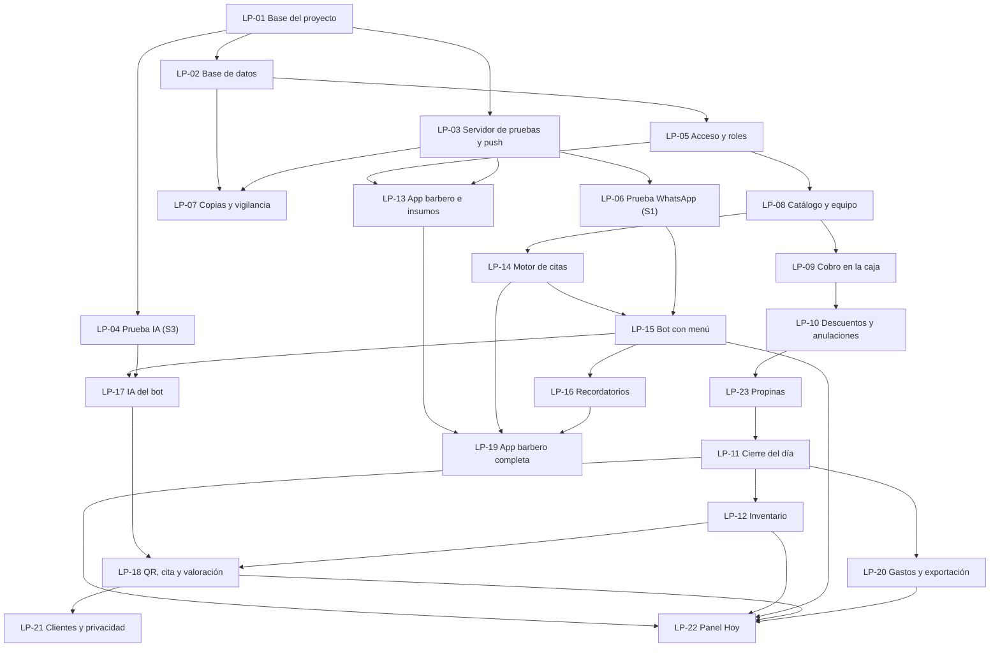

# Tickets — LOS PAPIS: caja, inventario y citas por WhatsApp

**Fecha:** 18 de octubre de 2026 · **Fuentes:** [PRD](../../los-papis-gestion-barberia.prd.md) · [Arquitectura](../../los-papis-gestion-barberia.architecture.md) · [Maqueta](https://claude.ai/artifact/L2wVJFP3VQK19vafBSJEmY)

## Resumen

El objetivo es que en LOS PAPIS cada euro, corte y producto quede registrado a nombre de alguien, que la caja cuadre cada día con un margen de 2 € y que los clientes aprendan a reservar por WhatsApp en italiano o español. Todo tiene que estar listo para pruebas a finales de enero de 2027.

Son **22 tickets** y siguen el orden de etapas del PRD:

- etapa 0: base y pruebas de riesgo;
- etapa 1: caja;
- etapa 2: inventario;
- etapa 3: citas y WhatsApp;
- etapa 4: panel y app del barbero.

Cada ticket es una sola cosa que se puede probar por separado y trae su propio contexto, así que un ciclo PIV puede empezarlo sin releer todo el proyecto.

**Proyecto desde cero:** todavía no hay código. Las carpetas de cada ticket son las que define la arquitectura (§4.1, Estructura): `apps/web`, `apps/api`, `packages/shared`, `packages/db` e `infra/`.

**Cómo empezar un ticket:** `/piv-plan-implementation` con el ticket (por ejemplo, "LP-01 de docs/tickets/los-papis-gestion-barberia.md"). Un ticket que depende de otro se planifica cuando ese otro ya está **construido**, no antes.

---

## Lo que necesitas tú, y cuándo

| Qué | Para qué ticket | Cuándo |
|---|---|---|
| Cuenta de GitHub (repositorio privado) | LP-01, para las pruebas automáticas | Esta semana |
| VPS en la UE y dominio | LP-03 | Ola 2 (finales de octubre) |
| Clave de la API de Anthropic, de pago por uso | LP-04 | Ola 2 |
| Número de teléfono nuevo y cuenta de Meta Business | LP-06 | Ola 3 (principios de noviembre) |
| Cuenta de almacenamiento para copias (otra empresa, en la UE) | LP-07 | Ola 3 |
| Lista real de servicios, precios, duraciones y productos | LP-08. Mientras tanto se usan los ejemplos de la maqueta | Ola 4 |
| Prueba S2: cobrar 20 veces con la maqueta en el iPad y cronometrar | Antes de LP-09 | Cuando quieras; ya se puede hacer |
| Reunión con el commercialista ([lista de preguntas](https://claude.ai/code/artifact/f2c992b8-259b-487e-9e52-4abd67571713)) | LP-11 (bloquea el cierre) y LP-20 (formato de exportación) | Antes de la ola 7 |
| Texto de privacidad en italiano y español | LP-15 y LP-18, para poder usarlos con clientes reales | Antes de los simulacros |
| Consulta al consulente del lavoro (art. 4) | LP-10, LP-19 y LP-22, para usarlos con los barberos reales | Antes de abrir |

---

## Tickets

### Etapa 0 — Base y pruebas de riesgo

### LP-01 — Base del proyecto

**Qué entrega:** el esqueleto del sistema funcionando en tu PC con Docker. Tiene el diseño de la maqueta, los dos idiomas y pruebas automáticas.

**Estado: HECHO el 19 de octubre de 2026** (commits `cb90d09` → `55104a6`; plan y desviaciones en `.claude/plans/lp-01-base-del-proyecto.md`). `pnpm check` verde (32 pruebas unitarias, 8 e2e), `docker compose up` sano en `http://localhost:8080`, GitHub Actions `check` #1 en verde.

**Criterios de aceptación**
- [x] Monorepo con pnpm, con `apps/web` (React 19, Vite 8, TanStack Router y Query, Tailwind 4, shadcn/ui), `apps/api` (Node 26 y Hono 4), `packages/shared`, `packages/db` (vacío por ahora) e `infra/`.
- [x] TypeScript 6 en modo estricto, con Biome, Vitest y Playwright configurados. `pnpm check` (tipos, estilo y pruebas) pasa.
- [x] Base del sistema de diseño tomada de la maqueta:
    - colores `#FCD116`, `#003893` y `#CE1126` sobre fondo neutro, en modo oscuro y claro;
    - fuentes Barlow Condensed y Geist;
    - números con ancho fijo;
    - franja tricolor 2:1:1;
    - cabecera con navegación.
- [x] Idiomas español e italiano con i18next y un selector de idioma. Ningún texto queda escrito directamente en el código; lo comprueba una prueba o una regla de estilo (Biome `noJsxLiterals` + prueba con la API del compilador de TypeScript).
- [x] El servidor tiene una ruta `/health` (y `/api/health`), y la pantalla muestra el estado que devuelve.
- [x] `docker compose up` levanta todo en Windows (Docker Desktop con WSL2). El README explica los comandos en español.
- [x] Repositorio git inicializado y un flujo de GitHub Actions que corre `pnpm check` con cada cambio.

**Contexto:** Arquitectura §4.1 (tecnología y estructura) y §4.4 (Diseño visual, Idiomas, Entornos) · Maqueta (cabecera, franja, colores y fuentes).
**Archivos (reales):** `apps/web`, `apps/api`, `packages/shared`, `packages/db`, `infra/docker/*.Dockerfile`, `infra/caddy/Caddyfile`, `compose.yaml`, `.github/workflows/check.yml`, `biome.json`, `tsconfig*.json`, `vitest.config.ts`, `README.md`.
**Tamaño:** ~900–1300 líneas, sobre todo configuración y la estructura de la app.
**Depende de:** nada.

### LP-02 — Base de datos: el libro que solo crece

**Qué entrega:** la regla de que "el dinero no se borra ni se edita", impuesta por la propia base de datos. También las herramientas de dinero en céntimos y el "día de caja" con hora de Roma.

**Estado: HECHO el 19 de octubre de 2026** (commits `92b97bf` → `5f356d7` más el de documentación; plan, spike y desviaciones en `.claude/plans/lp-02-base-de-datos.md`). `pnpm check` verde (90 pruebas unitarias e integración, 29 de ellas contra PostgreSQL 18 real; 8 e2e), `docker compose up --build` sano en `http://localhost:8080` con `db`, `api` y `web`, GitHub Actions `check` en verde con la base de datos levantada por el mismo `compose.yaml`.

**Criterios de aceptación**
- [x] Drizzle ORM 0.45.x (0.45.2 o posterior) con migraciones SQL y un comando para aplicarlas. Hay dos roles de base de datos: `owner`, que aplica migraciones, y `app`, que usa la aplicación. (drizzle-orm 0.45.4 + drizzle-kit 0.31.11; `pnpm db:migrate`; roles creados por `infra/postgres/init/01-roles.sh`.)
- [x] Tablas base: `shops` (a qué barbería pertenece cada dato), `users` (sin la lógica de acceso, que llega en LP-05) y `audit_events`.
- [x] Un patrón reutilizable para "tabla que solo crece": el rol `app` solo puede insertar y leer, y un trigger rechaza UPDATE y DELETE. Una prueba demuestra que no se puede editar ni borrar ni siquiera con SQL directo. (`CALL make_append_only('tabla')`: trigger `reject_mutation` siempre activo, también para TRUNCATE y para el dueño; `packages/db/test/append-only.test.ts`.)
- [x] Toda tabla de negocio lleva `shop_id`, y el acceso a datos siempre filtra por barbería. Una prueba lo verifica. (`CALL make_shop_scoped('tabla')`: Row Level Security con `withShop()`; `packages/db/test/shop-isolation.test.ts` comprueba además que toda tabla nueva de `public` esté clasificada.)
- [x] En `packages/shared`, el dinero en céntimos enteros:
    - formato `27,00 €` para italiano y español;
    - lectura de "12,50";
    - prohibido usar decimales flotantes, con pruebas de propiedades (fast-check 4.10.2, 200 casos por propiedad).
- [x] En `packages/shared`, el tiempo:
    - se guarda en UTC y se muestra en hora de Roma;
    - cálculo del "día de caja" (`cashDay`, `cashDayRange`);
    - pruebas de los cambios de hora del 28 de marzo y del 31 de octubre de 2027 (día de 23 h y de 25 h).
- [x] Las pruebas de integración corren contra PostgreSQL 18 real, en Docker y en CI (base de pruebas `los_papis_test`, vaciada y migrada en cada ejecución).

**Contexto:** Arquitectura §4.2 (modelo, reglas, Día de caja, Horario de Roma) y §1 (criterios 1 y 4) · PRD §6 (Reglas fijas).
**Archivos (reales):** `packages/db/` (`drizzle.config.ts`, `src/schema/*`, `src/{client,tenant,env,migrate,seed,registry}.ts`, `src/cli/*`, `drizzle/0000_patterns.sql`, `drizzle/0001_base-tables.sql`, `drizzle/0002_apply-patterns.sql`, `test/*`), `packages/shared/src/money.ts`, `packages/shared/src/time.ts` y sus pruebas, `infra/postgres/init/01-roles.sh`, `.env.example`, `compose.yaml`, `.github/workflows/check.yml`, `README.md`.
**Tamaño:** ~700–1000 líneas estimadas; reales ~2.700 añadidas (unas 950 de pruebas; el resto esquema, SQL, configuración, documentación e instantáneas JSON generadas por drizzle-kit).
**Depende de:** LP-01.

### LP-03 — Servidor de pruebas en el VPS, despliegue y avisos push (S4)

**Qué entrega:** el sistema publicado en `pruebas.<tu dominio>` con HTTPS, desplegado con un solo comando, y la respuesta a si los avisos push llegan a los móviles (prueba S4).

**Estado: HECHO el 19 de octubre de 2026; S4 decidido (push funciona en iPhone; Android se comprobará en el primer aparato disponible)** (commits `4de17c9` → `07f10b6` más el de documentación; plan, spike del servidor y desviaciones en `.claude/plans/lp-03-servidor-de-pruebas.md`). Adaptado a lo decidido el 18 de octubre: el VPS es compartido con las otras webs del dueño (LOS PAPIS va detrás de su nginx) y todavía no hay dominio, así que la app vive en `https://pruebas.37-27-38-218.sslip.io` (nombre temporal que resuelve a la IP; el cambio a `pruebas.<dominio>` es un paso documentado en el README) y las imágenes se construyen en el PC, no en el VPS (no tiene memoria de sobra). Desplegado y comprobado por HTTPS desde el PC: `/api/health`, `/api/push/config` con avisos activados, manifiesto, `sw.js` y redirección de HTTP a HTTPS. `pnpm check` en verde (162 pruebas unitarias e integración, 15 e2e) y GitHub Actions con el job `docker` nuevo.

**Criterios de aceptación**
- [x] VPS asegurado:
    - Ubuntu LTS (26.04.1);
    - SSH solo con llave (desde el 18 de octubre; usuario `lospapis` sin contraseña);
    - cortafuegos con 22, 80 y 443 (ufw ya los tenía abiertos para el nginx del dueño, más el 8443 de otra app suya; no se tocó);
    - actualizaciones de seguridad automáticas (`unattended-upgrades` activo);
    - usuario de despliegue sin root (`lospapis`, en el grupo `docker`);
    - Docker instalado (Docker CE 29.9 y Compose 5.6 del repositorio oficial). Además, swap de 2 GB porque el servidor comparte 3,8 GB con otras apps.
- [x] HTTPS para `pruebas.37-27-38-218.sslip.io` con nginx + certbot (webroot, renovación automática) en lugar de Caddy en el puerto 443, porque 80 y 443 son del nginx del dueño; Caddy sigue dentro del contenedor `web`, como en local. `app.<dominio>` y `pruebas.<dominio>` quedan para cuando exista el dominio. La base de datos no publica ningún puerto.
- [x] Secretos en `/opt/los-papis/.env` (permisos 600, generados en el propio servidor), nunca en el repositorio. `.env.example` documenta cada variable y `compose.server.yaml` exige las obligatorias con `${VAR:?}`.
- [x] Un solo comando (`pnpm deploy:pruebas`) construye las imágenes en el PC, las sube por ssh, aplica las migraciones (servicio `migrate` de un solo uso, antes de que arranque la API) y arranca. Volver atrás: `pnpm deploy:pruebas -Tag <etiqueta anterior> -SkipBuild`.
- [x] La app se puede instalar como PWA: manifiesto, iconos provisionales con "LOS PAPIS" (generados con Playwright) y service worker (solo avisos; sin modo sin conexión, como dice la arquitectura).
- [x] **Prueba S4:** la tarjeta "Avisos en este dispositivo" de Ajustes se suscribe con VAPID y envía un aviso de prueba con retardo; la API envía con `web-push`. **iPhone: funciona** (19-10-2026: dos avisos aceptados por Apple con 201 y recibidos con la app cerrada). **Android: sin probar** (el dueño no tiene Android; se prueba en el primero disponible antes de abrir). **Decisión tomada:** avisos push para citas y cobros, con novedades al abrir la app y WhatsApp para lo urgente como salvaguardas. Todo en `docs/spikes/S4.md`.

**Contexto:** Arquitectura §4.3 (VPS, Secretos), §4.4 (Entornos) y §6 (S4) · PRD (restricciones: VPS y dominio).
**Archivos (reales):** `infra/server/provision-pruebas.sh`, `infra/server/deploy-remote.sh`, `scripts/deploy-pruebas.ps1`, `compose.yaml`, `compose.server.yaml`, `infra/docker/api.Dockerfile`, `infra/caddy/Caddyfile`, `apps/api/src/push/*`, `apps/api/src/{migrate,env,index,app}.ts`, `apps/api/src/cli/vapid-keys.ts`, `apps/web/public/*` (manifiesto, iconos, `sw.js`), `apps/web/src/features/push/*`, `apps/web/src/pwa/register-sw.ts`, `apps/web/scripts/make-icons.ts`, `apps/web/e2e/pwa.spec.ts`, `packages/shared/src/push.ts`, `.github/workflows/check.yml` (job `docker`), `.env.example`, `docs/spikes/S4.md`, `README.md`.
**Tamaño:** ~500–900 líneas estimadas; reales ~3.600 añadidas (scripts del servidor, API de avisos, pantalla, pruebas y documentación).
**Depende de:** LP-01. **Necesita del dueño:** VPS (hecho), un iPhone y un Android para la prueba S4 (pendiente) y el dominio con su DNS (después; mientras tanto, nombre temporal).

### LP-04 — Prueba S3: ¿entiende Haiku 5.5 a los clientes?

**Qué entrega:** la decisión, con datos, de cuánto puede hacer la IA del bot. El conjunto de mensajes de prueba queda guardado para el futuro.

**Criterios de aceptación**
- [ ] 60 mensajes realistas en italiano, español y mezclados, con faltas y jerga, cada uno con su interpretación esperada:
    - intención: reservar, mover, cancelar, pregunta o hablar con una persona;
    - barbero, servicio y franja de día y hora;
    - idioma.
    Se escriben contigo, según cómo escribe tu clientela.
- [ ] Un prototipo de intérprete hace una llamada a Claude Haiku 5.5 (`claude-haiku-5-5`) con `@anthropic-ai/sdk` y devuelve una salida estructurada validada con Zod. El contexto que recibe son los servicios, los barberos, el horario y "hoy" en hora de Roma, nunca teléfonos.
- [ ] Un ejecutor de la prueba muestra el acierto por campo y total, el tiempo de respuesta (p50 y p95) y el costo por mensaje. El resultado queda en `docs/spikes/S3.md`, con la regla de decisión aplicada: 90% o más, entre 75% y 90%, o menos de 75%.
- [ ] Los mensajes y el ejecutor se quedan en el repositorio, como prueba de regresión para LP-17.

**Contexto:** Arquitectura §4.1 (IA del bot), §4.3 (Claude API), §4.4 (Flujo del bot) y §6 (S3) · skill `claude-api` (modelo y salidas estructuradas).
**Archivos (estimado):** `apps/api/src/modules/bot-ai/` (intérprete y esquema), `apps/api/test/bot-ai-eval/` (mensajes y ejecutor) y `docs/spikes/S3.md`.
**Tamaño:** ~400–700 líneas.
**Depende de:** LP-01. **Necesita del dueño:** la clave de la API de Anthropic.

### LP-05 — Acceso y roles

**Qué entrega:** cada persona entra con su cuenta y ve solo lo que le toca. En la caja, cada acción queda firmada con el PIN de un manager.

**Estado: HECHO el 19 de octubre de 2026** (commits `3584eb9` → `52e9386` más el de cierre; plan y desviaciones en `.claude/plans/lp-05-acceso-y-roles.md`). Una desviación de fondo: **sin Better Auth**, implementación propia con Hono y `node:crypto` (motivo en Arquitectura §4.1: la API va en un solo archivo, cookies `__Host-` solo con https y modo http en el PC, y la 2FA, el PIN y los dispositivos había que hacerlos a medida de todos modos). `pnpm check` en verde (333 pruebas unitarias e integración, 21 e2e con el flujo completo en navegador: `/configurar` → 2FA → entrar → PIN → dispositivo → barbero con contraseña temporal) y desplegado en `https://pruebas.37-27-38-218.sslip.io`, donde el dueño crea su cuenta en `/configurar` (ninguna contraseña ni código pasa por el chat). Queda para LP-08: exigir la aserción del PIN en cada cobro.

**Criterios de aceptación**
- [x] Usuario y contraseña (scrypt), sesiones en cookies `httpOnly` seguras (30 días, 14 sin uso), protección CSRF y límite de intentos (10 fallos bloquean 15 minutos; además 20 intentos por IP y usuario cada 15 minutos). Implementación propia en lugar de Better Auth 1.x.
- [x] Roles `manager` y `barbero`. El servidor revisa los permisos en cada ruta y, si no hay permiso explícito, niega. El barbero solo accede a lo suyo. Las pruebas cubren toda la tabla de roles del PRD §5 (`apps/api/src/auth/permissions.test.ts`).
- [x] Los managers tienen 2FA obligatoria con código del móvil (TOTP, RFC 6238, secreto cifrado en la base) y 8 códigos de respaldo de un solo uso. No hay correo en el MVP.
- [x] Dispositivos de caja: un manager con 2FA reciente autoriza el iPad o el PC una sola vez (cookie de 400 días). Hay una lista de dispositivos y se pueden revocar.
- [x] PIN de manager de 6 dígitos, guardado con hash (scrypt). Firma acciones con una aserción de 2 minutos. Se bloquea tras 5 fallos y lo desbloquea un manager con 2FA. Cada uso y cada fallo queda en `audit_events`, en la misma transacción.
- [x] Un manager puede crear cuentas de barbero y de manager (contraseña temporal mostrada una sola vez; cambio obligatorio al entrar), restablecer contraseñas y desactivar y reactivar cuentas. Las cuentas nunca se borran.
- [x] Pantallas en español e italiano: acceso (`/acceso`), primer manager (`/configurar`), configuración de 2FA con QR y códigos de respaldo, autorización de dispositivo, usuarios y teclado de PIN "¿Quién cobra?" igual que en la maqueta (rejilla de managers con iniciales, 6 puntos y teclado de 3 × 4 con teclas de 60 px).

**Contexto:** Arquitectura §4.3 (tabla completa), §4.1 (acceso: implementación propia) y §4.4 (Correo) · PRD §5 (Qué puede hacer cada rol) y §6 (Reglas fijas) · Maqueta (ventana del PIN en "Caja · Cobro").
**Archivos (reales):** `packages/shared/src/{auth,totp,base32}.ts`, `packages/db/src/schema/{auth,users}.ts` y migraciones `0003`/`0004`, `packages/db/src/test-db.ts`, `apps/api/src/auth/*` (crypto, tokens, permisos, csrf, límite de intentos, sesiones, cookies, guardias, servicio y rutas), `apps/api/src/{db,env,app,index,migrate}.ts`, `apps/api/test/*`, `apps/web/src/features/auth/*`, `apps/web/src/components/{pin-pad,pin-dialog}.tsx`, `apps/web/src/routes/{acceso,configurar,ajustes,caja,__root}.tsx`, `apps/web/e2e/{auth.setup,auth.spec,totp-codes,auth-files}.ts`, `compose.yaml`, `compose.server.yaml`, `infra/server/deploy-remote.sh`, `.env.example`, `README.md`.
**Tamaño:** ~1200–1500 líneas estimadas; reales ~9.000 añadidas (contrato, base, API, pantallas, pruebas y documentación).
**Depende de:** LP-02.

### LP-06 — Prueba S1: WhatsApp oficial y coexistencia

**Qué entrega:** el número de la barbería funcionando con la API oficial, la decisión sobre la coexistencia y la tarifa real de Italia.

**Criterios de aceptación**
- [ ] App de Meta y WhatsApp Cloud API conectadas al número nuevo. Tú haces los pasos en Meta y Claude te guía.
- [ ] Webhook en el servidor de pruebas: verifica la firma `X-Hub-Signature-256`, contesta enseguida, descarta los mensajes repetidos por su id y lo registra todo.
- [ ] Se envía texto, botones de respuesta y listas, y se reciben las respuestas.
- [ ] Hay 2 plantillas de recordatorio (italiano y español) aprobadas por Meta, y se envía una.
- [ ] El enlace del QR (`wa.me` con texto ya escrito) abre el chat, y el mensaje llega al webhook.
- [ ] Coexistencia probada durante una semana:
    - lo que contestas desde la app WhatsApp Business llega al sistema;
    - el bot se calla en ese chat;
    - no se pierde ningún mensaje.
    La decisión y la tarifa de Italia (tabla de precios de Meta en euros) quedan en `docs/spikes/S1.md`.
- [ ] El módulo de envío y recepción queda como base para LP-15.

**Contexto:** Arquitectura §4.3 (WhatsApp), §4.4 (Atención humana, Recordatorios, Valoraciones con QR), §5 (Piezas que faltan) y §6 (S1).
**Archivos (estimado):** `apps/api/src/modules/whatsapp/` (adaptador, firma, webhook), `infra/` (secretos) y `docs/spikes/S1.md`.
**Tamaño:** ~400–800 líneas.
**Depende de:** LP-03, porque necesita una dirección HTTPS. **Necesita del dueño:** el número nuevo y la cuenta de Meta Business (al principio sin verificar).

### LP-07 — Copias continuas, recuperación (S5) y vigilancia

**Qué entrega:** la garantía de que no se pierde ningún dato, comprobada con una recuperación real, y avisos si el sistema se cae.

**Criterios de aceptación**
- [ ] pgBackRest hace una copia completa diaria y envía cambios continuos a un almacenamiento S3 en la UE, de otra empresa distinta a la del VPS. Todo va cifrado.
- [ ] Se conserva lo suficiente para recuperar cualquier minuto de los últimos 35 días, más una copia mensual durante 12 meses.
- [ ] Hay un manual de recuperación en español y un script para hacerla.
- [ ] **Prueba S5:** en un servidor desechable, recuperar los datos a un minuto elegido y medir cuánto se tarda y cuántos datos se pierden. El resultado queda en `docs/spikes/S5.md`. Se aprueba con menos de 1 hora y menos de 5 minutos de datos perdidos.
- [ ] Cada día se comprueba que la copia se hizo. Un monitor externo gratuito vigila el servidor de pruebas y el de producción, y avisa al móvil del dueño. El canal (push o correo) se decide en este ticket.
- [ ] La ruta `/health` informa del estado de la base de datos y de la antigüedad de la última copia.

**Contexto:** Arquitectura §4.4 (Copias y recuperación, Fotos, Vigilancia), §4.1 (pgBackRest) y §6 (S5) · PRD (no perder nunca un registro).
**Archivos (estimado):** `infra/backup/` (configuración de pgBackRest, scripts), `docs/runbooks/recuperacion.md`, `docs/spikes/S5.md` y la ruta de estado en `apps/api`.
**Tamaño:** ~400–700 líneas.
**Depende de:** LP-02 y LP-03. **Necesita del dueño:** la cuenta de almacenamiento para las copias.

### Etapa 1 — Caja

### LP-08 — Catálogo y equipo

**Qué entrega:** los servicios, productos y barberos que usa la caja, gestionados por los managers.

**Estado: HECHO el 19 de octubre de 2026** (commits `00e3fc5` → `7c61bd1` más el de cierre; plan y desviaciones en `.claude/plans/lp-08-catalogo-y-equipo.md`). Pestañas nuevas **Catálogo** (Servicios | Productos) y **Equipo** para los managers, y en **Caja** la rejilla de servicios y productos con los chips de los barberos, como en la maqueta (solo lectura hasta LP-09). `pnpm check` en verde (405 pruebas unitarias e integración, 25 e2e) y desplegado en `https://pruebas.37-27-38-218.sslip.io` con los ejemplos de la maqueta cargados. Una desviación: las fotos se reducen en el propio iPad o PC (1024 px, JPEG) y el servidor las valida (tipo por bytes, 400 KB y 1600 px como máximo) antes de guardarlas en PostgreSQL; el motivo está en el plan.

**Criterios de aceptación**
- [x] Servicios: nombre en italiano y español, precio en céntimos y duración. Productos: nombre, foto, precio y si está activo. Barberos: perfil unido a su usuario, nombre visible y avatar (iniciales sobre un color de la paleta, o foto).
- [x] Pantallas del manager para ver, crear, editar y desactivar (y reactivar). Nada se borra: el rol `app` no tiene DELETE en estas tablas.
- [x] Cada cambio de precio queda en la auditoría (`service.price_changed`, `product.price_changed`) con el valor anterior y el nuevo. La caja lee el catálogo (`GET /api/catalog`, también el dispositivo sin usuario).
- [x] Fotos de productos (y de barberos) tomadas desde el iPad o el PC, reducidas en el dispositivo, validadas por el servidor y guardadas comprimidas en PostgreSQL (`photos`), así entran en la copia continua. Inmutables: cambiar la foto crea una fila y una URL nuevas.
- [x] Datos iniciales: `pnpm db:seed` y el servicio `migrate` (`SEED_CATALOG=example`) cargan los ejemplos de la maqueta sin tocar lo que ya existe; la lista real se añade en `packages/db/src/seed-catalog.ts` cuando el dueño la pase.

**Contexto:** Arquitectura §4.2 (Catálogo, Barbería y personas) y §4.4 (Fotos) · PRD §6 (etapa 1) y §9 (servicios y horarios) · Maqueta (casillas de servicios y productos).
**Archivos (reales):** `packages/shared/src/catalog.ts`, `packages/db/src/schema/catalog.ts`, `packages/db/src/seed-catalog.ts`, migraciones `0005`/`0006`, `apps/api/src/catalog/*` (imágenes, servicio, rutas), `apps/api/test/catalog.test.ts`, `apps/web/src/features/catalog/*`, `apps/web/src/routes/{catalogo,equipo,caja}.tsx`, `apps/web/src/lib/api-request.ts`, `apps/web/e2e/catalog.spec.ts`, `compose.yaml`, `compose.server.yaml`, `.env.example`, `README.md`.
**Tamaño:** ~900–1200 líneas estimadas; reales ~6.500 añadidas (contrato, base, API, pantallas, pruebas y documentación).
**Depende de:** LP-05. **Necesita del dueño:** la lista real de precios y de productos (mientras tanto, los ejemplos de la maqueta).

### LP-09 — Cobro en la caja

**Qué entrega:** un cobro completo, que se registra una sola vez, con su autor, y que no se puede modificar. Es la parte central de H1.

**Estado: HECHO el 19 de octubre de 2026** (commits `89805dc` → `52df585` más el de cierre; plan y desviaciones en `.claude/plans/lp-09-cobro-en-la-caja.md`). La caja cobra como en la maqueta y el libro de cobros (`sales`, `sale_lines`, `sale_payments`, `sale_receipts`) solo crece: ni el dueño de la base puede editar ni borrar. `pnpm check` en verde (464 pruebas unitarias e integración, 27 e2e) y desplegado en `https://pruebas.37-27-38-218.sslip.io`. **Prueba S2 resuelta de paso:** en el e2e del iPad tres cobros completos (barbero, dos servicios y un producto, efectivo con vuelto, PIN) tardaron 1,2 s, 0,9 s y 1,1 s dentro de la app; lo que mande será el tecleo en el registratore. Sin anulaciones ni descuentos todavía (LP-10) ni cierre (LP-11).

**Criterios de aceptación**
- [x] Pantalla de caja en el iPad y el PC como en la maqueta: elegir barbero; añadir servicios y productos y cambiar cantidades; efectivo o tarjeta; botones rápidos de lo que entrega el cliente (exacto y los importes redondos siguientes), con el vuelto calculado.
- [x] "Cobrar" pide el PIN del manager (LP-05: la aserción firmada de `/api/auth/pin/verify`, del mismo dispositivo). El cobro se guarda en el libro que solo crece con las líneas (precio y nombre del momento, tomados de la base y no del cliente), el pago (entregado y vuelto), el barbero, el manager, el dispositivo, la hora y el día de caja.
- [x] Cada cobro lleva un identificador que genera el dispositivo. Repetir la petición devuelve el cobro ya guardado (`idempotent: true`); dos peticiones iguales a la vez las separa la clave primaria; el mismo identificador con otro contenido responde 409. Pruebas de integración lo comprueban (reintento, carrera y conflicto).
- [x] Adaptador fiscal en modo manual: después del cobro, la caja muestra en grande "Registratore: 38,00 € · EFECTIVO" (o TARJETA) y permite guardar el número de recibo (fila nueva, una sola vez por cobro).
- [x] El cliente es opcional en el cobro (sin columna hasta LP-18, cuando exista la tabla de clientes).
- [x] Los managers ven "Cobros de hoy" bajo el cobro (y `GET /api/sales/day?day=`), solo para consulta.
- [x] E2E con Playwright en tamaño iPad del flujo completo, tres veces, midiendo el tiempo dentro de la app: mediana 1,1 s (< 30 s).
- [x] Los barberos no entran en la caja (la guardia los manda al inicio y sus pestañas son Panel y Ajustes) ni pueden cobrar ni ver los cobros (403 en la API); el dispositivo autorizado cobra sin usuario porque la barrera es el PIN. Pruebas de permisos en la API y en la guardia.

**Contexto:** PRD §4 (H1), §6 (etapa 1 y Reglas fijas) y §7 (métricas de H1) · Arquitectura §4.2 (Dinero), §4.4 (Adaptador fiscal, Cobros duplicados y reintentos) y §6 (S2) · Maqueta ("Caja · Cobro").
**Archivos (reales):** `packages/shared/src/sales.ts`, `packages/db/src/schema/sales.ts` y migraciones `0007`/`0008`, `apps/api/src/sales/{service,sales.routes}.ts`, `apps/api/test/sales.test.ts`, `apps/web/src/features/register/*`, `apps/web/src/routes/caja.tsx`, `apps/web/e2e/{register.spec,pin}.ts`, `README.md`.
**Tamaño:** ~1300–1500 líneas estimadas; reales ~5.500 añadidas (contrato, base, API, pantalla, pruebas y documentación).
**Depende de:** LP-08. **Prueba S2:** hecha con la caja real en vez de con la maqueta (ver arriba).

### LP-10 — Descuentos, cortes gratis, anulaciones y auditoría

**Qué entrega:** controles para el riesgo (c), los descuentos y cortes gratis inventados. Todo se hace con PIN y motivo, y se puede ver después.

**Estado: HECHO el 20 de octubre de 2026** (commits `ff22d0f` → `76c61cf` más el de cierre; plan y desviaciones en `.claude/plans/lp-10-descuentos-y-anulaciones.md`). Descuentos, cortes gratis y anulaciones como filas nuevas (`sale_discounts`, `sale_voids`) y visor de auditoría en la pestaña **Auditoría** (en italiano, **Registro**). `pnpm check` en verde (532 pruebas unitarias e integración, 33 e2e, las del cobro en el iPad) y desplegado en `https://pruebas.37-27-38-218.sslip.io`. De paso: las pestañas llevan candado mientras a la cuenta le falta un paso obligatorio (el dueño lo vio en el iPad con una cuenta nueva), la caja ya no se sale de la pantalla del móvil con un cobro a medias y un e2e comprueba que cada pestaña responde al toque en el iPad.

**Criterios de aceptación**
- [x] Descuentos de dos tipos, "fidelidad" (por ahora manual, porque la regla está pendiente) y "manager" (importe o porcentaje). Siempre llevan motivo y PIN, y quedan en la línea con quién los autorizó. *(Un solo PIN por cobro: el de "Cobrar" autoriza también sus descuentos; ver el plan.)*
- [x] Corte gratis: necesita la autorización de un manager y un motivo. Se guarda como descuento del 100% de tipo "cortesía": cuenta como corte y suma 0 €.
- [x] Anular un cobro pide PIN y motivo, y crea un registro de anulación. El cobro aparece como anulado en todas partes y nunca se borra.
- [x] Un cobro de un día ya cerrado no se anula: se corrige al día siguiente, con motivo. *(Hasta que exista el cierre de LP-11, "cerrado" = cualquier día de caja distinto del actual: 409 `sale_day_closed`. La corrección con motivo llega con los movimientos de caja de LP-11.)*
- [x] Visor de auditoría para el manager, con filtros por tipo (descuentos, cortes gratis, anulaciones, fallos de PIN, cambios de precio), por persona y por fecha.
- [x] Pruebas de permisos, de que nada se modifica y de que los totales no cuentan los cobros anulados.

**Contexto:** PRD §6 (Reglas fijas) y §1 (fuga c) · Arquitectura §4.2 (Anulación, Auditoría) y §4.3 (las acciones sensibles piden PIN y motivo) · Maqueta (botón "Aplicar descuento" y la fila anulada del panel).
**Archivos (reales):** `packages/shared/src/{sales,audit}.ts`, `packages/db/src/schema/sales.ts` y migraciones `0009`/`0010`, `apps/api/src/sales/*`, `apps/api/src/audit/*`, `apps/api/test/sale-adjustments.test.ts`, `apps/web/src/features/register/*` (diálogos de descuento y anulación), `apps/web/src/features/audit/*`, `apps/web/src/routes/auditoria.tsx`, `apps/web/e2e/{register,navigation}.spec.ts`, `README.md`.
**Tamaño:** ~1000–1300 líneas estimadas; reales ~5.800 añadidas sin contar los archivos generados (contrato, base, API, pantallas, pruebas y documentación).
**Depende de:** LP-09.

### LP-11 — Movimientos de caja y cierre del día

**Qué entrega:** el cierre diario que dice si la caja cuadra con un margen de 2 € y bloquea el día. Con esto se mide H1.

**Criterios de aceptación**
- [ ] Movimientos de caja firmados con PIN, en el libro que solo crece: fondo inicial, gasto pagado del cajón (con foto y motivo), depósito en el banco y retiro del dueño.
- [ ] Asistente de cierre como en la maqueta:
    - conteo por billetes y monedas;
    - lo esperado se calcula como fondo + cobros en efectivo no anulados + propinas en efectivo de esos cobros (LP-23) − salidas del cajón;
    - las propinas del día se entregan a cada barbero con PIN (salida del cajón "pago de propinas"; las de tarjeta, del efectivo o como diga el commercialista);
    - el total con tarjeta se compara con el informe del POS;
    - los totales del informe Z se comparan con el sistema.
- [ ] Regla de los 2 € (configurable). Si algo no coincide, el motivo es obligatorio.
- [ ] Al cerrar con PIN, el día de caja queda bloqueado. Lo que se cobre después va al día siguiente.
- [ ] Modo contingencia: los cobros del talonario hechos durante una caída se registran después, marcados como "contingencia" y con su número de papel.
- [ ] Historial de cierres, con lista y detalle, para los managers.
- [ ] Pruebas del cálculo de lo esperado, de la regla del margen, del bloqueo del día y de la marca de contingencia.
- [ ] **Requisito previo:** el commercialista confirma que el registro manual con el cruce del informe Z es válido. La respuesta queda en `docs/decisions/commercialista.md`.

**Contexto:** PRD H1 (95% de cierres con diferencia de 2 € o menos), §6 (Reglas fijas) y §7 · Arquitectura §4.2 (Movimiento de caja, Cierre diario, Día de caja) y §4.4 (Adaptador fiscal, Sin internet) · Maqueta ("Caja · Cierre del día").
**Archivos (estimado):** `packages/db/src/schema/cash.ts`, `apps/api/src/modules/cash/` y `apps/web/src/features/close/`.
**Tamaño:** ~1200–1500 líneas.
**Depende de:** LP-10. **Necesita del dueño:** las respuestas del commercialista.

**Fin de la etapa 1:** tú y tu esposa hacen un mini simulacro de caja con el servidor de pruebas antes de seguir (PRD §6: cada etapa se prueba antes de la siguiente).

### Etapa 2 — Inventario

### LP-12 — Inventario de productos

**Qué entrega:** controles para el riesgo (f), los productos que desaparecen. El stock sale de los movimientos y el conteo semanal lo compara con lo que hay en la estantería. Con esto se mide H2.

**Criterios de aceptación**
- [ ] El stock es la suma de movimientos que solo se añaden: compra, venta, devolución por anulación, ajuste, conteo, uso interno y dañado.
- [ ] Cada cobro genera la salida del producto y cada anulación lo devuelve al stock.
- [ ] Las casillas de la caja muestran "Quedan N" o "Agotado". Por defecto no deja vender más de lo que hay.
- [ ] El manager registra las compras. Los ajustes llevan motivo y PIN.
- [ ] Conteo semanal: contado frente al sistema por producto. Las diferencias quedan con su explicación y en un historial, que es la métrica de H2.
- [ ] Cada producto tiene un umbral de "queda poco", y hay una lista de avisos.

**Contexto:** PRD H2, §6 (etapa 2) y §1 (fuga f) · Arquitectura §4.2 (Inventario) · Maqueta (casillas de productos y bloque "Inventario" del panel).
**Archivos (estimado):** `packages/db/src/schema/stock.ts`, `apps/api/src/modules/stock/`, `apps/web/src/features/inventory/` y cambios pequeños en `apps/web/src/features/register/`.
**Tamaño:** ~1000–1300 líneas.
**Depende de:** LP-11.

### LP-13 — App del barbero (base) e insumos

**Qué entrega:** la app del barbero en el móvil y el botón "se acabó tal insumo", que avisa a los managers al momento.

**Criterios de aceptación**
- [ ] App web instalable en el móvil del barbero, con acceso, una pantalla "Hoy" provisional y la elección de idioma.
- [ ] Los managers gestionan la lista de insumos.
- [ ] El barbero toca "se acabó" o "queda poco" (con foto opcional). El aviso llega a los managers por Web Push (de LP-03) y aparece en una lista del panel. El manager lo marca como "pedido" o "repuesto".
- [ ] El manager puede apuntar "se agotó sin aviso", que es la métrica de H2. Todo queda en el historial.
- [ ] El barbero solo ve lo suyo. Las pruebas de permisos lo comprueban.

**Contexto:** PRD H2, §5 (trabajo del barbero) y §6 (etapa 2) · Arquitectura §4.1 (PWA y Web Push) y §4.2 (Aviso de insumo) · resultado de S4 (`docs/spikes/S4.md`).
**Archivos (estimado):** `apps/web/src/features/barber-app/`, `packages/db/src/schema/supplies.ts`, `apps/api/src/modules/supplies/` y `apps/api/src/modules/push/`.
**Tamaño:** ~800–1100 líneas.
**Depende de:** LP-05 y LP-03. Se puede hacer en paralelo con LP-12.

**Fin de la etapa 2:** conteo de prueba del inventario en el servidor de pruebas.

### Etapa 3 — Citas y WhatsApp

### LP-14 — Motor de citas y agenda del panel

**Qué entrega:** la agenda que nunca acepta dos citas a la vez con el mismo barbero, porque lo impide la base de datos, y la vista de agenda del manager.

**Criterios de aceptación**
- [ ] Horario de cada barbero, con pausas y días libres, más el horario de la barbería y la duración de cada servicio.
- [ ] Horas libres por barbero, servicio y día, en hora de Roma y correctas en los cambios de hora.
- [ ] Citas con estados (reservada, movida, cancelada, no vino, terminada), historial de cambios y origen (bot o panel).
- [ ] Una restricción de exclusión de PostgreSQL impide citas solapadas para el mismo barbero. Una prueba lo demuestra: de dos reservas simultáneas, una falla.
- [ ] Agenda del manager: vista del día por barbero, con línea de tiempo, para crear, mover y cancelar. Usa un registro mínimo de cliente (nombre y teléfono).
- [ ] El motor deja las funciones listas para el bot (LP-15).

**Contexto:** PRD H3 (cero dobles reservas) y §6 (etapa 3) · Arquitectura §4.2 (Agenda, Clientes, Horario de Roma) y §1 (criterio 3).
**Archivos (estimado):** `packages/db/src/schema/agenda.ts`, `apps/api/src/modules/agenda/` y `apps/web/src/features/agenda/`.
**Tamaño:** ~1300–1500 líneas.
**Depende de:** LP-08. *Atajo opcional:* como no toca la caja, se puede empezar en otra sesión mientras va la etapa 1. Ahorra más o menos una semana, pero adelanta la etapa 3 antes de probar la 1. Lo decides tú.

### LP-15 — Bot de WhatsApp: reservar, mover y cancelar (menú)

**Qué entrega:** el bot con botones en italiano y español. El cliente reserva, mueve y cancela solo, y puede pedir hablar con una persona.

**Criterios de aceptación**
- [ ] Flujo de conversación sobre el adaptador de LP-06:
    - primer contacto;
    - elección de idioma;
    - aviso de privacidad y consentimiento;
    - menú con reservar, mis citas (mover o cancelar) y hablar con una persona.
- [ ] Reserva con botones y listas: barbero, servicio, día, hora libre (de LP-14) y confirmación. La confirmación es gratis porque el cliente escribió hace menos de 24 horas.
- [ ] El cliente puede mover y cancelar sus citas.
- [ ] Atención humana: la conversación se marca y el bot se calla unas horas. Se responde con la coexistencia o con una bandeja en el panel, según lo que decida S1.
- [ ] Los mensajes se procesan en la cola de pg-boss, sin duplicados. Conversaciones y mensajes quedan registrados, para las métricas de H3: cuántas se resuelven sin ayuda y cuántas piden una persona.
- [ ] Pruebas con mensajes de webhook grabados que recorren los flujos completos, más una carrera de dos reservas simultáneas por el bot.

**Contexto:** PRD H3 y §6 (etapa 3) · Arquitectura §4.4 (Flujo del bot, Atención humana), §4.3 (WhatsApp) y §4.2 (Bot) · resultado de S1.
**Archivos (estimado):** `apps/api/src/modules/bot/` (máquina de estados, flujos, textos IT/ES), `packages/db/src/schema/bot.ts` y la bandeja en `apps/web/src/features/inbox/` si S1 la pide.
**Tamaño:** ~1300–1500 líneas.
**Depende de:** LP-14 y LP-06. **Necesita del dueño:** el texto de privacidad (mientras tanto se usa uno provisional).

### LP-16 — Recordatorios y avisos al cliente

**Qué entrega:** recordatorios automáticos y aviso al cliente si la barbería cambia su cita, con el costo bajo control.

**Criterios de aceptación**
- [ ] Recordatorio unas horas antes de la cita, con plantilla de pago en italiano o español, programado con pg-boss. No se envía si la cita se canceló. La antelación se configura.
- [ ] Si un barbero o un manager cancela o mueve una cita, el cliente recibe la plantilla correspondiente.
- [ ] Los envíos que fallan se reintentan con espera creciente. Los que fallan del todo aparecen en el panel, en "mensajes que no salieron", con opción de reintentar.
- [ ] Se lleva la cuenta del costo por tipo de mensaje, para compararlo con los 45 €/mes.

**Contexto:** Arquitectura §4.4 (Recordatorios, Cobros duplicados y reintentos) y §4.1 (tabla de costos) · tarifa real de S1.
**Archivos (estimado):** `apps/api/src/modules/notifications/`, `apps/api/src/jobs/` y la vista en `apps/web/src/features/inbox/` o en el panel.
**Tamaño:** ~700–1000 líneas.
**Depende de:** LP-15.

### LP-17 — IA del bot: texto libre con Haiku 5.5

**Qué entrega:** el bot entiende mensajes como "domani alle 5 con Marco" y los convierte en una propuesta que el cliente confirma con un botón.

**Criterios de aceptación**
- [ ] El intérprete de LP-04 entra en la conversación. Cuando el cliente escribe texto libre:
    - la IA lo interpreta;
    - el bot salta al paso del menú que corresponde, con barbero, servicio y día ya rellenados;
    - ofrece las horas libres en botones;
    - el cliente confirma.
    La IA nunca escribe directamente en la agenda.
- [ ] Interruptor en el panel para encenderla o apagarla. El modo (completo, solo intención o apagado) sale de la decisión de S3.
- [ ] Si tarda más de unos 4 s, falla o rechaza la petición, el bot vuelve a los botones. Quedan registrados los tokens, el tiempo y el costo.
- [ ] La prueba de 60 mensajes de LP-04 se pasa antes de cambiar el prompt o el modelo.

**Contexto:** Arquitectura §2 (bot híbrido), §4.4 (Flujo del bot), §4.3 (Claude API) y §6 (S3) · skill `claude-api`.
**Archivos (estimado):** `apps/api/src/modules/bot-ai/`, el punto de enganche en `apps/api/src/modules/bot/` y el interruptor en ajustes del panel.
**Tamaño:** ~700–1000 líneas.
**Depende de:** LP-15 y LP-04. Se puede hacer en paralelo con LP-16.

### LP-18 — La caja conoce al cliente: QR, cita y valoración

**Qué entrega:** el cobro queda unido al cliente y a su cita, y el cliente valora al barbero gratis. Con esto se mide "% de clientes con cita" (H3) y se guardan los datos para el ranking.

**Criterios de aceptación**
- [ ] QR para imprimir: un enlace `wa.me` con texto ya escrito, en italiano y español. Al escanearlo empieza el registro en el bot:
    - pide el consentimiento si el cliente es nuevo;
    - registra la visita y guarda el teléfono;
    - el cliente aparece en la caja en "recién registrados por QR";
    - el manager lo asigna al cobro con un toque.
- [ ] Franja "Citas ahora" en la caja: al tocar una cita, el cobro se rellena con su barbero y sus servicios, y queda unido a la cita.
- [ ] Valoración: después de un cobro con cliente y con el chat abierto, el bot pide de 1 a 5 estrellas y un comentario opcional. Se guarda por barbero y por cobro.
- [ ] Contador de visitas por cliente, visible para el manager en la caja. La regla de fidelidad sigue pendiente.

**Contexto:** PRD §6 (etapas 1 y 4), métrica de H3 y §9 (fidelidad) · Arquitectura §2 (Valoraciones), §4.4 (Valoraciones con QR) y §4.2 (Valoraciones y fidelidad) · Maqueta (botón "Asignar cliente" y franja "Citas ahora").
**Archivos (estimado):** `apps/api/src/modules/bot/` (flujo del QR y valoración), `apps/api/src/modules/sales/` (unión con cliente y cita), `apps/web/src/features/register/` y `packages/db/src/schema/ratings.ts`.
**Tamaño:** ~1100–1400 líneas.
**Depende de:** LP-17 y LP-12. Ambas tocan el bot y la caja, así que van una detrás de otra.

**Fin de la etapa 3:** prueba del bot con 10–20 amigos (PRD §6).

### Etapa 4 — Panel y app del barbero

### LP-19 — App del barbero: agenda, facturado y cambios de cita

**Qué entrega:** el barbero organiza su día desde el móvil sin depender del dueño.

**Criterios de aceptación**
- [ ] Agenda del día y de la semana, solo con sus citas y solo el nombre de los clientes. Se actualiza en vivo (SSE) y avisa con push de citas nuevas, cambiadas o canceladas.
- [ ] Puede cancelar o mover sus citas, y el cliente recibe el aviso de LP-16.
- [ ] Vista "facturado": la suma de sus cobros por día y por mes. Qué significa "ganancias" para un barbero con sueldo fijo sigue pendiente; por ahora se muestra solo lo facturado.

**Contexto:** PRD §5 (trabajo del barbero y tabla de roles) · Arquitectura §4.1 (PWA y push), §4.3 (Barberos) y §4.4 (Tiempo real).
**Archivos (estimado):** `apps/web/src/features/barber-app/`, `apps/api/src/modules/agenda/` (rutas del barbero) y `apps/api/src/modules/realtime/`.
**Tamaño:** ~900–1200 líneas.
**Depende de:** LP-13, LP-14 y LP-16.

### LP-20 — Gastos, ganancia del mes y exportación para el commercialista

**Qué entrega:** la ganancia real del mes y un archivo para el commercialista sin tener que copiar nada a mano.

**Criterios de aceptación**
- [ ] Gastos que no salen del cajón: categoría, importe, fecha, forma de pago y foto del recibo. Los sueldos se apuntan como gasto mensual.
- [ ] Vista mensual: ingresos (efectivo y tarjeta, servicios y productos) menos gastos, igual a la ganancia.
- [ ] Exportación para el commercialista en CSV o Excel. Incluye cobros con anulaciones y descuentos, pagos por forma, cierres y gastos. El contenido y el formato los decide el commercialista.

**Contexto:** PRD §6 (etapa 4: gastos y ganancia) y §9 (commercialista) · Arquitectura §4.2 (Gastos) · `docs/decisions/commercialista.md`.
**Archivos (estimado):** `packages/db/src/schema/expenses.ts`, `apps/api/src/modules/expenses/`, `apps/api/src/modules/export/` y `apps/web/src/features/expenses/`.
**Tamaño:** ~900–1200 líneas.
**Depende de:** LP-11. **Necesita del dueño:** el formato de exportación que pida el commercialista.

### LP-21 — Clientes y privacidad

**Qué entrega:** la lista de clientes y el cumplimiento del GDPR sin romper la regla de que el dinero no se borra.

**Criterios de aceptación**
- [ ] Lista de clientes para el manager, con buscador: visitas, última visita, consentimientos y citas.
- [ ] Exportar los datos de un cliente.
- [ ] Si un cliente pide que borren sus datos, se anonimizan el nombre y el teléfono. Sus cobros siguen intactos, ahora como "cliente anonimizado" (Arquitectura §4.3, Privacidad).
- [ ] Si el cliente retira el consentimiento, deja de recibir recordatorios y peticiones de valoración.
- [ ] Una tarea borra o anonimiza datos según el plazo de conservación que se acuerde (pendiente).

**Contexto:** Arquitectura §4.3 (Privacidad) y §7 (pregunta abierta de privacidad) · PRD (restricción de GDPR).
**Archivos (estimado):** `apps/api/src/modules/clients/`, `apps/web/src/features/clients/` y `apps/api/src/jobs/retention.ts`.
**Tamaño:** ~700–1000 líneas.
**Depende de:** LP-18.

### LP-22 — Panel del manager "Hoy"

**Qué entrega:** el panel de la maqueta con datos reales. Todas las métricas del PRD se ven en una sola pantalla.

**Criterios de aceptación**
- [ ] Indicadores del día:
    - cobrado hoy, separado en efectivo y tarjeta;
    - número de cobros;
    - ticket medio;
    - % de clientes que llegaron con cita, frente a la meta del 30%;
    - estado de la caja.
- [ ] Bloques del panel:
    - cobros en vivo (SSE);
    - gráfico de la semana;
    - últimos cierres;
    - barberos del mes en privado (cortes y valoraciones);
    - avisos de inventario;
    - números del bot (H3).
- [ ] Todo se calcula a partir de los libros, sin datos puestos a mano. Cada métrica tiene su prueba.
- [ ] El interruptor del ranking público existe y está apagado.

**Contexto:** PRD §7 (todas las métricas) y H1–H3 · Arquitectura §4.4 (Tiempo real) · Maqueta ("Panel del manager").
**Archivos (estimado):** `apps/web/src/features/dashboard/`, `apps/api/src/modules/metrics/` y `apps/api/src/modules/realtime/`.
**Tamaño:** ~1000–1300 líneas.
**Depende de:** LP-11, LP-12, LP-15, LP-18 y LP-20.

**Fin de la etapa 4:** el sistema queda listo para las pruebas de febrero y marzo (PRD §6).

### LP-23 — Propinas para los barberos

**Qué entrega:** la caja registra la propina de cada cobro para su barbero, aparte de la facturación: no entra en el total del cobro, ni en la línea del registratore, ni en los totales de lo cobrado. Al final del día se sabe cuánto le toca a cada barbero, en efectivo y con tarjeta. *Añadido el 20 de octubre de 2026 a petición del dueño; va entre LP-10 y LP-11.*

**Estado: HECHO el 20 de octubre de 2026** (commits `06abab9` → `bff28e7` más el de cierre; plan y desviaciones en `.claude/plans/lp-23-propinas.md`). Propina en la pantalla del registratore y desde "Cobros de hoy", tabla `sale_tips` que solo crece, propinas del día por barbero aparte de los totales y filtro "Propinas" en la auditoría. `pnpm check` en verde (555 pruebas unitarias e integración, 35 e2e) y desplegado en `https://pruebas.37-27-38-218.sslip.io`. La entrega a los barberos llega con el cierre (LP-11); el trato fiscal de las propinas con tarjeta, con la respuesta del commercialista.

**Criterios de aceptación**
- [x] Justo después de cobrar (pantalla del registratore) y desde "Cobros de hoy" se añade la propina de un cobro: importe (botones rápidos de 1, 2 y 5 €, otro importe y, en efectivo, "el vuelto como propina") y forma (efectivo o tarjeta; por defecto, la del cobro). Una por cobro, para el barbero del cobro.
- [x] La firma un manager con su PIN; justo después de cobrar vale la firma del cobro (2 minutos) y no se vuelve a pedir.
- [x] Fila nueva en un libro que solo crece (`sale_tips`): importe, forma, barbero, manager, dispositivo, hora y día de caja. Nunca se edita; si el cobro se anula, su propina deja de contar.
- [x] La propina no cambia el cobro: el registratore sigue mostrando solo el cobro. Con tarjeta, la pantalla dice qué teclear en el POS (cobro + propina); en efectivo, el vuelto que queda.
- [x] "Cobros de hoy" enseña la propina de cada cobro y, aparte de los totales del cobro, las propinas del día: en efectivo, con tarjeta y por barbero.
- [x] Auditoría: cada propina deja su evento y el visor tiene el filtro "Propinas".
- [x] Solo cobros del día de caja actual, como las anulaciones (hasta el cierre de LP-11).
- [x] Pruebas de permisos, de una sola propina por cobro, de que nada se modifica, de que los totales del cobro no la cuentan y de que las de cobros anulados no cuentan; e2e en el iPad.

**Contexto:** petición del dueño (20/10/2026) · PRD §6 (Reglas fijas: todo deja rastro) · Arquitectura §4.2 (Dinero, el libro que solo crece) · LP-09 y LP-10 (cobro, PIN y anulaciones).
**Archivos (reales):** `packages/shared/src/{sales,audit}.ts`, `packages/db/src/schema/sales.ts` y migraciones `0011`/`0012`, `packages/db/test/sale-tips.test.ts`, `apps/api/src/sales/*`, `apps/api/test/sale-tips.test.ts`, `apps/web/src/features/register/{tip-form,use-tip-recorder,sale-done,today-sales,today-sale-row}.tsx`, `apps/web/src/features/audit/audit-labels.ts`, `apps/web/e2e/register.spec.ts`, `README.md`.
**Tamaño:** ~1200–1500 líneas estimadas.
**Depende de:** LP-10. **Lo usa:** LP-11 (lo esperado en efectivo suma las propinas en efectivo; el cierre entrega a cada barbero sus propinas). **Pregunta para el commercialista:** cómo se documentan y se pagan las propinas con tarjeta (el TPV cobra cobro + propina; el registratore, solo el cobro).

---

## Gráfico de dependencias

## Orden de ejecución sugerido

Sigue el orden de etapas del PRD. Los tickets de una misma ola **se pueden hacer en paralelo** en sesiones separadas, porque casi no comparten archivos. Si dos de ellos añaden migraciones, al juntarlos hay que regenerar la de uno de los dos.

| Ola | Tickets | Etapa | Calendario orientativo |
|---|---|---|---|
| 1 | LP-01 | 0 | 19–25 de octubre |
| 2 | LP-02 · LP-03 · LP-04 | 0 | finales de octubre |
| 3 | LP-05 · LP-06 · LP-07 | 0 | primera semana de noviembre |
| 4 | LP-08 | 1 | noviembre |
| 5 | LP-09 | 1 | noviembre |
| 6 | LP-10 → LP-23 (propinas, añadido a petición del dueño) | 1 | noviembre |
| 7 | LP-11 → mini simulacro de caja | 1 | finales de noviembre |
| 8 | LP-12 · LP-13 | 2 | principios de diciembre |
| 9 | LP-14 | 3 | diciembre |
| 10 | LP-15 | 3 | diciembre |
| 11 | LP-16 · LP-17 | 3 | diciembre |
| 12 | LP-18 → prueba del bot con amigos | 3 | principios de enero |
| 13 | LP-19 · LP-20 · LP-21 | 4 | enero |
| 14 | LP-22 | 4 | hasta el 31 de enero de 2027 |

**Atajo opcional:** LP-14 se puede adelantar a la ola 5, en otra sesión, porque no toca la caja.
