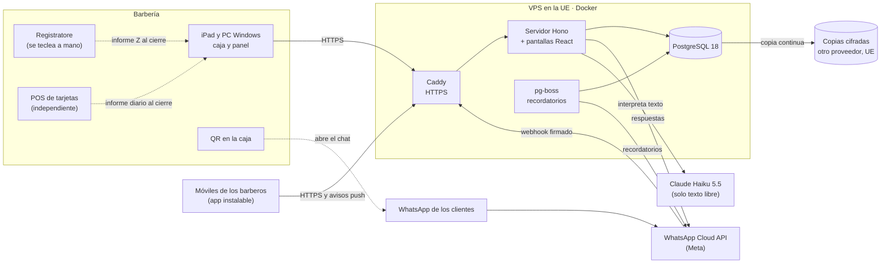

# Arquitectura — LOS PAPIS: caja, inventario y citas por WhatsApp

**Fecha:** 18 de octubre de 2026 · **Intención:** [PRD](los-papis-gestion-barberia.prd.md) · **Estado:** decisiones tomadas con el dueño · **Tickets:** [docs/tickets/los-papis-gestion-barberia.md](docs/tickets/los-papis-gestion-barberia.md)
**Quién construye:** Claude escribe todo el código; el dueño decide producto y costos · **Operación:** máximo 45 €/mes

Este documento decide **cómo** se construye lo que pide el PRD: el enfoque, la tecnología, la forma de los datos, las fronteras de seguridad y qué hay que probar antes de construir. No es un plan de tareas. El plan detallado se hace por ticket con `piv-plan-implementation`.

---

## 1. Problema y objetivos

LOS PAPIS necesita que cada euro, cada corte y cada producto quede registrado a nombre de alguien, y que la caja cuadre el mismo día (H1, H2). También quiere que los clientes aprendan a reservar solos por WhatsApp, en italiano o en español (H3). Todo con un sistema propio, sin suscripciones, que cueste como mucho 45 €/mes, mantenido por Claude para un dueño que no programa y listo para pruebas a finales de enero de 2027.

Cada decisión de este documento se mide con estos criterios, en este orden:

1. **Integridad del dinero:** nada se pierde ni se borra, y todo tiene autor.
2. **Caja rápida:** unos 30 segundos por cobro un sábado de 40–50 clientes.
3. **Ninguna doble reserva.**
4. **Ningún dato perdido**, aunque se rompa el servidor.
5. **Fácil de operar** para una persona con Claude, dentro del presupuesto.
6. **Interfaz minimalista y de primer nivel** en iPad, PC y móvil.

## 2. Enfoques considerados

### Forma del sistema

| Enfoque | A favor | En contra | Veredicto |
|---|---|---|---|
| **A. Una sola app web en un VPS** | Una sola cosa que mantener. El bot necesita estar en internet de todas formas. Se entra desde cualquier sitio, las copias están en un solo lugar y queda preparado para varias barberías | Depende de internet en el local | **Elegido** |
| B. Servidor dentro de la barbería, más un VPS para el bot | Funciona sin internet y está en la misma red que el registratore | Son dos sistemas que hay que mantener sincronizados, con riesgo de dobles reservas. El equipo queda expuesto a robos o averías y es difícil de vender | Descartado |
| C. Adaptar Odoo Community y añadir un bot propio | Caja, inventario y módulos fiscales italianos ya hechos | Pesado y difícil de simplificar. Las reglas propias habría que programarlas igual, dentro de un sistema complejo, y cada actualización rompe las personalizaciones | Descartado |

### Tecnología

| Opción | Veredicto |
|---|---|
| **TypeScript: React (SPA) y una API con Hono** | **Elegida.** Claude escribe todo el código y el dueño quiere una interfaz de primer nivel, y para eso el ecosistema de React es el más fuerte. Las pantallas y el servidor comparten los tipos de datos, así que un cambio que no encaja falla al compilar y no en la barbería. |
| Python con Django | Era la recomendación si el dueño fuera a mantener el código, porque trae seguridad y panel de administración. Para pantallas tipo app se queda por detrás de React. |
| PHP con Laravel | Tan completo como Django y con la misma desventaja en las pantallas. Además tiene menos herramientas oficiales para la IA del bot. |
| Next.js | Su ventaja es generar páginas en el servidor y el posicionamiento en buscadores, y aquí no hace falta porque la app es interna. Tiene más piezas de seguridad que vigilar (acciones de servidor, middleware). Una SPA con una API aparte es más fácil de entender. |

### Bot de WhatsApp

| Opción | Veredicto |
|---|---|
| Solo menú (botones y listas) | Es la base del bot |
| Solo IA conversacional | Descartado: cada mensaje cuesta y es más difícil de probar |
| **Híbrido: menú más una IA que entiende texto libre** | **Elegido.** La IA nunca reserva: propone una cita, el servidor comprueba que sea posible y el cliente confirma con un botón. Modelo: **Claude Haiku 5.5**, elegido por el dueño por costo |

### Valoraciones

| Opción | Veredicto |
|---|---|
| Mensaje automático después de pagar | Descartado: entre 20 y 45 €/mes, porque se paga cada mensaje que inicia la barbería |
| **QR en la caja: el cliente escribe primero** | **Elegido.** No cuesta nada. Además registra la visita para la fidelidad y el teléfono del cliente, con su permiso |

### Recibo fiscal

| Opción | Veredicto |
|---|---|
| Automático: el sistema envía cada cobro al registratore por la red | Lo recomendó Claude; **no se elige por ahora** |
| Servicio fiscal en la nube | Descartado: tiene cuota mensual |
| **Manual: el manager teclea el total en el registratore** | **Elegido por el dueño.** Para reducir errores, la caja muestra qué hay que teclear, y el cierre lo compara con el informe Z. Pasar después al modo automático es un cambio acotado (ver *Adaptador fiscal*) |

## 3. Enfoque recomendado

Una sola aplicación web en un VPS de la UE, con tres partes:

- **la caja y el panel**, en el iPad y el PC Windows de la barbería;
- **la app de los barberos**, que se instala en sus móviles;
- **el bot de WhatsApp**, conectado a la API oficial de Meta.

Un solo servidor TypeScript atiende las tres partes, guarda todo en PostgreSQL y programa los recordatorios. El dinero y el stock se llevan como **libros que solo crecen**: nada se edita, y una corrección es un registro nuevo. El registratore y el POS siguen funcionando por su cuenta en el local, y cada noche el cierre compara sus informes con el sistema.

## 4. Decisiones clave

### 4.1 Tecnología y librerías

Son las versiones vigentes en octubre de 2026. Al empezar, se fijan exactas en el lockfile.

| Capa | Elección | Por qué | Descartado |
|---|---|---|---|
| Lenguaje | TypeScript 6.x | Un solo lenguaje con tipos en todo el sistema. TypeScript 7 (compilador nativo) se adopta cuando la 7.1 traiga una API estable para las herramientas | JavaScript sin tipos |
| Entorno de ejecución | Node.js 26 LTS (es LTS desde el 28 de octubre de 2026 y tiene soporte hasta abril de 2029) | Su soporte cubre la apertura y bastante más | Node 24, que pasa a mantenimiento en octubre de 2026 |
| Pantallas | React 19 + Vite 8 | Es el estándar para apps ricas, y Vite 8 compila muy rápido | Next.js |
| Navegación y datos en pantalla | TanStack Router + TanStack Query | Rutas y caché con tipos. Permite que la caja muestre el cambio al instante, antes de que conteste el servidor | — |
| Diseño | Tailwind CSS 4, shadcn/ui (sobre Radix), Motion y los iconos Lucide | Componentes accesibles y minimalistas cuyo código queda dentro del proyecto, con animaciones suaves | Librerías de componentes cerradas, como MUI |
| Gráficos | Recharts | Sencillo para el panel del manager | — |
| Idiomas | i18next | Español e italiano desde el primer día | — |
| App de los barberos | App web instalable (PWA) con avisos Web Push | Gratis y sin tiendas de apps. Los avisos funcionan en iPhone (iOS 16.4 o posterior, con la app en la pantalla de inicio) y en Android | App nativa; avisos por WhatsApp, que cuestan |
| Servidor | Hono 4 | Ligero y moderno, con un cliente con tipos para las pantallas | Express, Fastify |
| Validación | Zod 4, compartido | Las mismas reglas en la pantalla y en el servidor | — |
| Base de datos | PostgreSQL 18 | Una restricción de exclusión impide citas solapadas. Las transacciones y los triggers hacen cumplir que los libros solo crezcan | SQLite, MySQL |
| Acceso a datos | Drizzle ORM 0.45.x (0.45.2 o posterior), con migraciones SQL revisadas | Se parece mucho a SQL y deja escribir restricciones y triggers. Se pasa a la 1.0 cuando sea estable; hoy es una versión candidata | Prisma |
| Acceso de usuarios | Implementación propia con Hono y `node:crypto` (sesiones opacas en cookies `httpOnly`, scrypt, TOTP con WebCrypto, códigos de respaldo, PIN, dispositivos de caja) — **cambiado en LP-05 (19-10-2026)**; antes decía Better Auth 1.x | El MVP no usa correo y Better Auth gira alrededor del email; sus consultas no fijan la barbería (RLS); el PIN, los dispositivos y la auditoría son a medida de todas formas; son cuatro personas; y "que todo el sistema sea nuestro". La organización por barbería sigue en las tablas (`shop_id`); el multi-tenant por dominio llega si se vende a otras barberías | Better Auth 1.x (descartado por lo anterior), Lucia (ya no se mantiene como librería) |
| Tareas programadas | pg-boss | Una cola dentro de PostgreSQL para recordatorios y reintentos, sin Redis | BullMQ con Redis |
| WhatsApp | WhatsApp Cloud API oficial, directamente con Meta | Sin intermediarios, sin cuotas y sin riesgo de que bloqueen el número | Intermediarios con cuota, como Twilio; librerías no oficiales, que violan las condiciones de uso |
| IA del bot | Claude Haiku 5.5 (`claude-haiku-5-5`) con el SDK oficial `@anthropic-ai/sdk` | Elección del dueño: menos de 1 €/mes. Una llamada por cada mensaje de texto libre, con respuesta estructurada y validada | Claude Opus 5.5, más capaz, unos 5–10 €/mes |
| Servidor web y HTTPS | Caddy 2 | Certificados automáticos | Nginx con certbot |
| Contenedores | Docker Compose | El mismo paquete en el PC de desarrollo (Windows) y en el VPS | Instalar todo a mano |
| Copias de seguridad | pgBackRest hacia almacenamiento S3 en la UE, de otro proveedor | Copia continua, cifrada, que permite recuperar hasta cualquier minuto | pg_dump cada noche, que podría perder un día entero |
| Calidad | Biome (formato y errores de estilo), Vitest y Playwright | Herramientas rápidas. Playwright prueba la caja con el tamaño de pantalla del iPad | — |
| Repositorio y CI | GitHub privado con GitHub Actions | Gratis, y las pruebas corren con cada cambio | — |
| Estructura | Un solo repositorio con pnpm: `apps/web` (pantallas), `apps/api` (servidor), `packages/shared` (tipos, reglas, dinero y fechas), `packages/db` (esquema y migraciones) e `infra/` (Docker, Caddy, copias) | Todo junto, con los tipos compartidos | Repositorios separados |

**Costo mensual estimado (aproximado):**

| Concepto | €/mes |
|---|---|
| VPS (4 núcleos, 8 GB, 80 GB, en la UE) con instantáneas | 8–15 |
| Almacenamiento de copias en otro proveedor | 1–3 |
| Dominio | ~1 |
| WhatsApp: recordatorios (plantilla utility, unos 0,025 € cada uno según un intermediario; se confirma en S1) | 6–10 |
| Claude Haiku 5.5 en modo híbrido | < 1 |
| **Total** | **~16–30** |

### 4.2 Modelo de datos (forma, no columnas)

| Grupo | Entidades | Reglas |
|---|---|---|
| Barbería y personas | Barbería · Usuario (rol de manager o barbero, PIN de manager, 2FA) · Perfil de barbero (horario, ausencias) · Dispositivo autorizado (iPad, PC) | Todo registro lleva a qué barbería pertenece. El barbero solo ve lo suyo |
| Clientes | Cliente (teléfono único por barbería, nombre, idioma) · Consentimiento (qué aceptó, cuándo y por qué canal) | El barbero ve solo el nombre de sus clientes, nunca el teléfono |
| Catálogo | Servicio (nombre en IT y ES, precio, duración) · Producto (foto, precio) · Insumo (cantidad mínima) | Los cambios de precio quedan en la auditoría, y cada cobro guarda el precio de ese momento |
| Agenda | Cita (cliente, barbero, servicio, franja horaria, estado, origen: bot o panel) | La base de datos impide que dos citas del mismo barbero se solapen. Cada cambio de estado queda en el historial |
| **Dinero (solo se añade)** | Cobro · Línea (servicio o producto, cantidad, precio guardado, descuento con motivo y quién lo autorizó) · Pago (efectivo o tarjeta, entregado, vuelto) · Anulación (motivo, quién) · Movimiento de caja (gasto pagado del cajón, depósito, retiro, fondo inicial) · Cierre diario (efectivo esperado frente a contado por billetes, tarjeta frente al POS, totales del informe Z, diferencia y explicación) | La app no puede modificar ni borrar estas tablas; lo impiden los permisos de la base de datos y triggers. Los importes van en céntimos, como números enteros. Cada registro guarda quién lo hizo, cuándo y desde qué dispositivo |
| **Inventario (solo se añade)** | Movimiento de stock (compra, venta, ajuste, conteo, uso interno, dañado) · Aviso de insumo (quién lo dio y en qué estado está) | El stock es la suma de los movimientos y nunca se edita a mano |
| Gastos | Gasto (categoría, importe, fecha, forma de pago, foto del recibo) | Si se paga del cajón, también genera un movimiento de caja |
| Valoraciones y fidelidad | Valoración (cliente, barbero, cobro, de 1 a 5, comentario) · Visita (sale de los cobros que tienen cliente) · Regla de fidelidad (configurable, pendiente de definir) | El ranking público queda apagado, pero los datos se guardan desde el primer día |
| Bot | Conversación (estado, idioma, "la atiende una persona" hasta tal hora) · Mensaje (entrante o saliente, id único de WhatsApp, categoría, costo) · Interpretación de la IA (texto, resultado, tiempo de respuesta, tokens) | El id único evita procesar dos veces el mismo mensaje. De aquí salen las métricas de H3 |
| Auditoría | Evento (quién, qué, sobre qué, valor anterior y nuevo, motivo, dispositivo, hora) | Solo se añade |

- **Día de caja.** Cada cobro pertenece a un día de caja. Una vez cerrado, ese día queda bloqueado.
- **Horario de Roma.** Todo se guarda en UTC y se muestra en hora de Roma, con pruebas para los cambios de hora de verano e invierno.

### 4.3 Fronteras y seguridad

| Frontera | Cómo funciona | Seguridad |
|---|---|---|
| Navegadores ↔ servidor | API por HTTPS con tipos compartidos | Cookies de sesión seguras y protección contra peticiones falsificadas (CSRF). El servidor revisa los permisos en cada ruta y, si no hay permiso explícito, niega. Límite de intentos de acceso y de PIN |
| Caja (iPad y PC) | Un manager con 2FA autoriza el dispositivo una sola vez, y cada cobro lleva el PIN del manager que cobra | PIN de 6 dígitos, bloqueo tras 5 fallos. Anular, aplicar descuentos, dar cortes gratis y sacar dinero del cajón piden PIN y motivo |
| Managers fuera de la barbería | Contraseña más 2FA | Códigos de respaldo para recuperar la cuenta, porque el MVP no envía correos |
| Barberos | Su cuenta en su propio móvil | Solo ven sus citas, el nombre de sus clientes y lo que han facturado |
| WhatsApp Cloud API (Meta) | Webhook de entrada y envío de mensajes | Se verifica la firma `X-Hub-Signature-256`. El servidor contesta enseguida y procesa el mensaje en la cola. El id del mensaje evita duplicados. El token de sistema se guarda como secreto |
| Claude API (Anthropic) | Una llamada por cada mensaje de texto libre, con salida estructurada y validada | La clave solo vive en el servidor. Se envía solo el texto necesario, nunca teléfonos. Si la IA tarda más de unos 4 segundos o falla, el bot muestra botones |
| Copias de seguridad | Almacenamiento compatible con S3, en la UE y en otro proveedor | Se cifran antes de salir del servidor, con claves separadas |
| Registratore y POS | Sin conexión con el sistema; un *adaptador fiscal* en modo manual | El cierre los cruza con el informe Z y con el informe del POS |
| VPS | — | Abiertos solo los puertos 80 y 443, más SSH con llave. Actualizaciones de seguridad automáticas. La base de datos no está expuesta y los contenedores no corren como root |
| Secretos | Archivo de entorno en el servidor, nunca en el repositorio | Diferentes en local, pruebas y producción. Se cambian si alguien deja el equipo |

**Privacidad:** el servidor y las copias están en la UE. Los encargados del tratamiento son Meta (WhatsApp), Anthropic (texto de los mensajes), el proveedor del VPS y el de las copias. El consentimiento se registra cuando el cliente escribe por primera vez, ya sea con el QR o al reservar. Si un cliente pide borrar sus datos, se anonimizan su nombre y su teléfono, y sus cobros quedan intactos, porque el libro del dinero no se borra.

### 4.4 Otras decisiones

- **Flujo del bot.** Con el primer mensaje, el cliente elige el idioma, y queda guardado. Después, los botones y listas de WhatsApp le permiten reservar, mover o cancelar, y elegir barbero, servicio y hora. Si escribe texto libre, Haiku 5.5 lo convierte en una intención estructurada (barbero, servicio, día y hora aproximados). El servidor ofrece las horas libres como botones y el cliente confirma. La IA nunca escribe en la agenda.
- **Atención humana.** Si el cliente pide "hablar con una persona", la conversación se marca y el bot se calla durante unas horas. El manager contesta desde la app WhatsApp Business con el mismo número (coexistencia). Si la coexistencia no funciona bien en la prueba S1, se construye una bandeja de mensajes dentro del panel.
- **Recordatorios.** La confirmación se envía en el momento, y es gratis porque el cliente acaba de escribir. Además hay un recordatorio unas horas antes de la cita (plantilla de pago). Si un barbero cancela, se avisa al cliente con otra plantilla.
- **Valoraciones con QR.** El QR es un enlace de WhatsApp con un texto ya escrito. Cuando el cliente lo envía, el bot pide su consentimiento, busca su cobro del día y le pide de 1 a 5 estrellas y un comentario opcional. Con eso queda registrada la visita para la fidelidad. En la caja, el manager puede asignar el cobro a un cliente de la lista de "recién registrados por QR", sin teclear el teléfono.
- **Adaptador fiscal, en modo manual.** Al terminar cada cobro, la caja muestra en grande lo que hay que teclear: "Registratore: 27,00 € · EFECTIVO". Opcionalmente se guarda el número de recibo. En el cierre se introducen los totales del informe Z por forma de pago y se comparan con el sistema. El modo automático (registratore en red) será otra versión del mismo adaptador y no toca el resto del sistema.
- **POS independiente.** El cierre compara el total con tarjeta del sistema con el informe diario del POS. Integrarlos es una decisión que se puede tomar más adelante.
- **Tiempo real.** El panel y los móviles se actualizan solos cuando entra una cita o un cobro, mediante eventos que envía el servidor (SSE).
- **Cobros duplicados y reintentos.** Cada cobro lleva un identificador que genera el propio dispositivo, así que un doble toque o un reintento de red nunca crea dos cobros. Las tareas fallidas se reintentan con espera creciente, y las que fallan del todo se ven en el panel ("mensajes que no salieron").
- **Sin internet.** En la versión 1 no hay modo sin conexión. El respaldo es el hotspot del móvil y un talonario numerado; el registratore emite recibos aunque no haya internet. Los cobros del talonario se pasan después marcados como "contingencia", con su número de papel. Como el libro solo crece, más adelante se puede añadir una cola local en el dispositivo.
- **Copias y recuperación.** Copia continua con pgBackRest y una completa cada día. Se puede recuperar a cualquier minuto de los últimos 35 días, y se guarda una copia mensual durante 12 meses. Además, el proveedor del VPS hace una instantánea semanal. Una vez al mes se prueba una recuperación.
- **Fotos.** Las fotos de productos y de recibos se guardan comprimidas dentro de PostgreSQL. Así entran en la copia continua sin tener que respaldar aparte otra carpeta de archivos.
- **Entornos.** Hay tres: *local* (el PC Windows con Docker Desktop), *pruebas* (el mismo VPS con otro subdominio, otra base de datos y el número de prueba de WhatsApp) y *producción*. Para desplegar, GitHub Actions corre las pruebas y el VPS construye la versión con un solo comando.
- **Idiomas.** El panel está en español e italiano, y cada usuario elige el suyo. El bot habla italiano o español según elija el cliente. Ningún texto queda escrito directamente en el código.
- **Diseño visual.** Minimalista, con modo oscuro y claro; la caja empieza en modo oscuro. Paleta de Colombia sobre fondo neutro: amarillo `#FCD116` como acento principal, azul `#003893` como secundario y rojo `#CE1126` solo para alertas, acciones peligrosas y algún detalle de marca. En el iPad los botones miden al menos 48 px. En el PC hay atajos de teclado y un buscador rápido con Ctrl+K. Hasta que haya logo, se usa "LOS PAPIS" escrito como marca.
- **Correo.** El MVP no usa correo. La 2FA se recupera con códigos de respaldo y el manager restablece las contraseñas de los barberos.
- **Vigilancia.** Registros ordenados y una ruta de estado del servidor. Un monitor externo gratuito avisa al móvil del dueño si el sistema se cae. Cada día se comprueba que la copia se hizo.
- **Pruebas.**
    - Pruebas unitarias de dinero, cierre, descuentos, permisos, reglas de agenda y cambios de hora.
    - Pruebas contra un PostgreSQL real de las restricciones y de que los libros solo crecen.
    - Playwright para la caja y el cierre con el tamaño del iPad.
    - Conversaciones del bot reproducidas con mensajes grabados.
    - Un conjunto de mensajes de prueba para la IA, que se pasa antes de cambiar el prompt o el modelo.

## 5. Piezas que faltan

- **VPS en la UE** (el dueño lo compra en estos días) y **dominio**.
- **Número de teléfono nuevo** para la barbería y **cuenta de Meta Business**. Sin verificar funciona con límites bajos, suficientes para probar. La verificación pide los datos de la empresa, es decir, la partita IVA.
- **Cuenta de Anthropic** (API de pago por uso).
- **Almacenamiento para las copias** en otro proveedor, en la UE.
- **Repositorio privado** en GitHub.
- **Logo:** todavía no hay. Mientras tanto se usa la marca escrita con la paleta.
- **Catálogo:** servicios con precio y duración, horarios de la barbería y de cada barbero, productos con fotos y lista de insumos.
- **Equipos:** iPad, PC Windows, registratore (después de hablar con el commercialista), POS del banco, cajón de dinero y el QR impreso.
- **Textos legales:** informativa de privacidad en italiano y español, texto de consentimiento y aviso a los barberos sobre el art. 4.
- **Plantillas de WhatsApp** en italiano y español: recordatorio y "la barbería canceló tu cita".

## 6. Pruebas antes de construir (spikes)

**S1 — WhatsApp oficial y coexistencia**
- **Pregunta:** ¿Se puede tener el número nuevo funcionando con la API oficial, con botones, con plantillas aprobadas en IT y ES, y que además se pueda usar desde la app WhatsApp Business para hablar con clientes?
- **Prueba:** crear la cuenta de Meta Business, la app y el número. Recibir y contestar con botones y listas. Aprobar 2 plantillas. Probar el enlace del QR y usar la coexistencia durante una semana. Lleva 2–3 días de trabajo, más la espera de Meta.
- **Regla:** si en una semana no se pierde ningún mensaje y el bot se calla cuando contesta una persona, la atención humana se hace con la coexistencia. Si no, el número queda solo para la API y se construye una bandeja de mensajes en el panel. De paso se confirma la tarifa real de Italia en la tabla de precios en euros de Meta.

**S2 — Velocidad de la caja en el iPad**
- **Pregunta:** ¿Se puede cobrar en 30 segundos o menos, incluyendo el PIN, la forma de pago y teclear el importe en el registratore?
- **Prueba:** un prototipo navegable de la pantalla de cobro en el iPad, con el que los dos managers hacen 20 cobros simulados cronometrados. Lleva 1–2 días.
- **Regla:** si la mediana es de 30 segundos o menos, se construye así. Si es más, se simplifica: el PIN se pide al empezar el turno y se cambia de manager con un toque, hay favoritos y menos pasos. Luego se repite la prueba.

**S3 — La IA del bot con Haiku 5.5**
- **Pregunta:** ¿Entiende bien Haiku 5.5 los mensajes reales en italiano, en español y mezclados?
- **Prueba:** 60 mensajes realistas, con faltas y jerga ("domani alle 5 con Marco", "un fade el sábado por la tarde"), midiendo si acierta la intención, el barbero, el servicio y el día y la hora. Lleva 1 día y cuesta unos céntimos.
- **Regla:** con 90% de aciertos o más, híbrido completo. Entre 75% y 90%, la IA solo entiende la intención y responde preguntas frecuentes, y el día y la hora se eligen con botones. Por debajo de 75%, solo menú, y el dueño decide si se prueba un modelo más capaz.

**S4 — Avisos en los móviles**
- **Pregunta:** ¿Llegan los avisos push a la app instalada en el iPhone y en el Android de los barberos?
- **Prueba:** instalar la app de prueba en los dos móviles y mandar avisos. Lleva medio día.
- **Regla:** si llegan en los dos, se usan avisos push. Si falla alguno, la app muestra las novedades al abrirse y, si hace falta, se avisa por WhatsApp, con costo.

**S5 — Recuperación tras un desastre**
- **Pregunta:** ¿Se puede recuperar todo hasta el último minuto si el servidor se rompe?
- **Prueba:** con datos de prueba, borrar un servidor de pruebas y recuperarlo en otro a partir de la copia. Lleva 1 día y se hace antes de los simulacros de febrero.
- **Regla:** si la recuperación tarda menos de una hora y se pierden menos de 5 minutos de datos, se aprueba. Si no, se ajusta la configuración y se repite. Después se repite cada mes.

**Requisito previo, sin prueba:** antes de construir el cierre de la etapa 1 hay que hablar con el commercialista. Tiene que confirmar que el registro manual con el cruce del informe Z es válido, qué IVA lleva cada cosa y qué hay que guardar y durante cuánto tiempo.

## 7. Preguntas abiertas

- [ ] **Commercialista:** ¿basta con el registro manual y el cruce con el informe Z? ¿Qué IVA y qué régimen se aplican? ¿Cuánto tiempo hay que conservar los datos? *(Bloquea el cierre de la etapa 1.)*
- [ ] **Consulente del lavoro:** ¿las cámaras y el registro de lo que hace cada barbero necesitan acuerdo o autorización (art. 4)?
- [ ] **Privacidad:** texto de la informativa, cuánto tiempo se guardan los datos de clientes, y acuerdos de tratamiento con Meta, Anthropic, el proveedor del VPS y el de las copias.
- [ ] **Regla de fidelidad:** cuántas visitas, qué descuento, y si se aplica sola o la aplica el manager.
- [ ] **Bono privado:** cómo se calcula.
- [ ] **Propinas:** si se aceptan con tarjeta, de quién son y cómo se registran.
- [ ] **Nombre del dominio.**
- [ ] **Tarifa real de WhatsApp en Italia** (se confirma en S1).
- [ ] **Registratore automático:** cuándo dar el paso. Por ejemplo, si los cierres muestran errores de forma de pago o si la caja va lenta.
- [ ] **Varias barberías:** cuándo activarlo. Hoy solo existe el campo que dice a qué barbería pertenece cada dato.

## 8. Orden y calendario orientativo

| Semanas (desde el 19 de octubre de 2026) | Qué |
|---|---|
| 1–2 | Base del proyecto, sistema de diseño con la paleta y spikes S1–S4 |
| 3–6 | Etapa 1: cobro, PIN, anulaciones, salidas de caja y cierre (después del commercialista) |
| 7–8 | Etapa 2: inventario, conteos y avisos de insumos |
| 9–11 | Etapa 3: bot, primero con menú y después con la IA |
| 12–13 | Etapa 4: valoraciones con QR, panel del manager y app de los barberos |
| 14–15 (hasta el 31 de enero de 2027) | Endurecer el sistema: copias (S5), revisión de seguridad y paso a producción en el VPS |
| Febrero–marzo de 2027 | Simulacros del PRD y ajustes antes de abrir |
